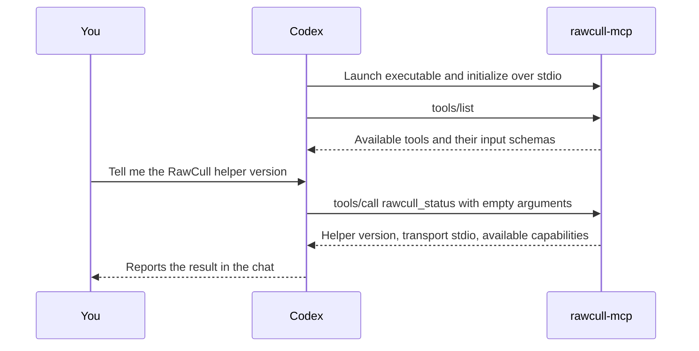

# RawCull MCP implementation plan

**Status.** Signed builds passed the Phase 1 metadata and revocation checks and the Phase 2 analysis smoke tests. The Phase 3 TestFlight walkthrough is complete across builds `448` and `449` and the earlier Rekdal run. Clean-account and broader Phase 2 checks remain open. Preview sharing and review drafts are planned.

## What the user should be able to do

1. In RawCull, choose a catalog to make available to a desktop AI client.
2. Quit RawCull and ask the client about that catalog. The client starts a bundled MCP helper on demand.
3. In Phase 2, ask RawCull to analyze an authorized catalog, group bursts, and rank candidates.
4. In Phase 3, ask RawCull to add a catalog and run a job. Select the source folder and approve the job in RawCull when prompted.
5. Ask the assistant to compare the top frames and revisit uncertain picks. Open RawCull later and review a saved draft with suggested keepers, alternatives, and reasons. Apply individual picks or an explicitly selected batch using the existing culling workflow.

The first release stops after step 2. A good demo is “How many photos are in this catalog, and what cameras and capture dates does it cover?” It proves client setup, catalog authorization, a useful tool call, and operation with the app closed before introducing models, image sharing, and catalog writes.

## How a local MCP call works

MCP stands for Model Context Protocol. It gives an AI client a standard way to discover tools, call them with arguments, and receive results. In this setup, Codex is the client and `rawcull-mcp` is the server. The RawCull window and the MCP helper are separate processes. A local server can be a small executable that starts on demand and waits for messages.



1. **Codex starts the helper.** The MCP configuration gives Codex the absolute path to `rawcull-mcp`. Codex launches that executable and connects two pipes to it. `stdio` means that the client sends messages through the helper's standard input and reads replies from its standard output. There is no local web address or port to configure. When the client closes the input pipe, the helper exits.
2. **Codex discovers the tools.** After the MCP handshake, Codex sends `tools/list`. The helper returns each tool’s name, description, and JSON input schema. The `rawcull_status` tool takes no arguments. That information tells the model what operation it can use and how to call it.
3. **The model interprets your prompt.** When you ask for the helper version, the model in Codex chooses `rawcull_status`. Codex turns that choice into a structured MCP request. The helper receives the tool name and arguments. Codex retains the natural-language prompt and conversation.
4. **The helper runs Swift code.** The MCP Swift SDK decodes the request and hands it to the `CallTool` handler. The handler validates the tool name and arguments, then returns the helper version, transport, and available capabilities. The implementation lives in [the helper's main.swift](../Tools/RawCullMCP/Sources/RawCullMCP/main.swift).
5. **Codex shows the result.** The helper returns a human-readable line and structured JSON. Codex can use that response to answer you or decide what to call next. The terminal line `Called rawcull.rawcull_status` identifies the server and tool that actually ran.

For example, the request in step 3 looks like this on the wire. The numeric ID lets Codex match the reply to the request.

```json
{"jsonrpc":"2.0","id":1,"method":"tools/call","params":{"name":"rawcull_status","arguments":{}}}
```

Phase 2 uses the same flow for burst analysis. Codex can start analysis for an authorized catalog ID, poll for progress, and request the ranked frames. RawCull scans, scores, and groups the photos. If preview sharing were enabled, the assistant could inspect selected frames, then send structured suggestions to a draft-saving tool. Opening the draft in RawCull would let you decide which picks to apply. These tools are planned for later phases.

The helper runs locally on the Mac. Where the model interprets your prompt depends on the client and model you use. A cloud model may receive data that a tool returns. The Phase 1 helper returns status and authorized catalog metadata, including filenames and capture metadata. The later preview-sharing setting will determine whether the helper can return image previews for the selected catalog. [MCP Swift SDK](https://github.com/modelcontextprotocol/swift-sdk), [MCP stdio transport](https://ruby.sdk.modelcontextprotocol.io/server/transports/)

## What RawCull can reuse

| Existing code | Role in the integration |
| --- | --- |
| [ScanFiles](../RawCull/Actors/ScanFiles.swift) and RawParserKit | Reuse supported RAW formats and catalog discovery rules. Check which scan and metadata operations can run without UI state or GUI-owned caches. |
| [CatalogLifecycleCoordinator](../RawCull/Model/ViewModels/CatalogLifecycleCoordinator.swift) | Shows how RawCull holds security-scoped access during work. Reuse the app’s existing access for Phase 2 jobs. |
| [BurstAnalysisCoordinator](../RawCull/Intelligence/BurstAnalysis/BurstAnalysisCoordinator.swift) and RawCullCore | The coordinator already orchestrates sharpness, similarity, grouping, and ranking, but takes app callbacks and publishes through app state. Run the existing app pipeline when the helper submits a job. |
| [RawCullIntelligenceRuntime](../RawCull/Intelligence/Composition/RawCullIntelligenceRuntime.swift) | Starting point for understanding model discovery and initialization. Use the running app’s model setup and availability for Phase 2. |
| [CullingModel](../RawCull/Model/ViewModels/CullingModel.swift) | Existing APIs for ratings and burst winner overrides. The app uses these when the user applies a draft. The helper writes proposals to a separate draft store. |

## Phase 0 — Prove the launch and sandbox

### Run the local status prototype

From the repository root, build the standalone Swift package. The first build fetches the locked Swift dependencies.

```sh
swift build --package-path Tools/RawCullMCP -c release --force-resolved-versions
```

Point a desktop MCP client's local stdio server configuration at the absolute path to `Tools/RawCullMCP/.build/release/rawcull-mcp`. For example, to register it in Codex CLI from the repository root:

```sh
codex mcp add rawcull -- "$PWD/Tools/RawCullMCP/.build/release/rawcull-mcp"
```

Start a new client session and ask, “Use `rawcull_status` to tell me the RawCull MCP helper version and available capabilities.” The standalone helper reports version `0.7.0`, a null `appBuild`, transport `stdio`, and the Phase 1 through Phase 3 tools. Use a signed bundled build for the shared catalog snapshot test. RawCull itself can be closed. Use the bundled build below to test the installed app layout.

### Test the bundled helper with TestFlight

Xcode builds the helper as a separate target and copies it to `Contents/MacOS` inside `RawCull.app`. The helper has its own bundle identifier and App Sandbox entitlement because Codex launches it directly. Its identifier is also embedded in the executable's `Info.plist` so macOS can identify it when applying the sandbox. The status prototype requires only the two pipes from Codex. It has no catalog grants or network entitlements. [Apple's guidance on identifying a sandboxed command-line executable](https://developer.apple.com/forums/thread/802443)

Upload an internal build with `./Scripts/release.sh internal` and install it from TestFlight after Apple processes it. Quit RawCull, then confirm the helper is present and signed. Adjust the path if RawCull is installed elsewhere. If `rawcull` already points to another helper, run `codex mcp remove rawcull` before registering this one.

```sh
helper=/Applications/RawCull.app/Contents/MacOS/rawcull-mcp
codesign --verify --strict --verbose=2 "$helper"
codex mcp add rawcull -- "$helper"
```

Start a fresh Codex CLI session. The original 0.1.0 TestFlight build exposed one tool. If `/mcp` labels the server `unknown`, invoke the tool to verify the connection. Ask “Call `rawcull_status` on the `rawcull` MCP server and tell me the helper version and available capabilities.” Confirm that Codex shows a tool call to `rawcull.rawcull_status` and reports the installed helper version over `stdio`.

### Implementation sequence

1. Build a small Swift executable using the [official MCP Swift SDK](https://github.com/modelcontextprotocol/swift-sdk). Pin a tested revision. Use the SDK's stdio transport and one tool, `rawcull_status`, that reports the helper version and supported capabilities. Keep protocol messages on stdout and diagnostics on stderr or in unified logging.
2. Run it from an MCP test client, then from one desktop AI client that supports launching a local stdio server. Verify discovery, invocation, and exit on client disconnect. Record the tested client version and configuration.
3. Embed and sign the helper in a Release build. Repeat the test from an installed copy with the RawCull UI closed. Test the external client itself as the launcher, since Apple's sandbox inheritance example describes a tool launched by its containing app. Validate the archive's nested signing and entitlements. A working executable launched from Xcode or Terminal does not prove this path. [Apple's embedded tool guidance](https://developer.apple.com/documentation/xcode/embedding-a-helper-tool-in-a-sandboxed-app)
4. Verify that the signed helper can read the shared authorization and saved metadata after RawCull quits. The installed Phase 1 helper passed this check, including revocation. Any future direct access to source files from the helper needs its own signed-build test. [Apple’s sandbox file access guidance](https://developer.apple.com/documentation/security/accessing-files-from-the-macos-app-sandbox)

## Phase 1 — Ship one read-only workflow

### Test a signed local build

Create a local archive from the repository root.

```sh
xcodebuild -project RawCull.xcodeproj -scheme RawCull \
  -configuration AppStore -destination 'generic/platform=macOS' \
  -archivePath /tmp/RawCull-MCP-Test.xcarchive \
  -allowProvisioningUpdates archive
```

In Finder, open `/tmp/RawCull-MCP-Test.xcarchive/Products/Applications/` and copy the archived app to `/Applications/RawCull-MCP-Test.app`. Verify the signed helper and register it once. If `rawcull` already points to another helper, run `codex mcp remove rawcull` before registering this one. Keep the same path when replacing the test app with a newer archive.

```sh
helper=/Applications/RawCull-MCP-Test.app/Contents/MacOS/rawcull-mcp
codesign --verify --strict --verbose=2 "$helper" &&
  codex mcp add rawcull -- "$helper"
```

Quit any running RawCull instance and open the test copy directly from Finder. Select `/Users/thomas/Downloads/100MSDCF`, wait for the 809 photos to load, choose **Settings → MCP → Authorize Selected Catalog**, and quit RawCull. In a fresh Codex CLI session, try this prompt. If the CLI reports that its background app server failed to start, use `codex --no-daemon`.

> Call `list_catalogs` on `rawcull`. Use the catalog ID for `100MSDCF` at `/Users/thomas/Downloads/100MSDCF` to call `catalog_summary` and `list_photos` with a limit of 5. Show the summary, check that it reports 809 photos, and show both pages of photos, using `nextCursor` to fetch the second page.

Reopen the test app, choose **Revoke Access**, quit, and call `list_catalogs` again. Expect an empty list.

### Clearing shared results

In **Settings → MCP**, **Last shared result** shows the current completed burst analysis even when there is no saved catalog authorization. A completed result remains available after quitting RawCull. It has no automatic expiry and stays available until you clear it or the current job is replaced or removed.

**Clear Last Shared Result** removes rankings and coverage from future MCP reads and preserves any saved catalog authorization and snapshot. An earlier setup receipt may still return the same IDs on replay. Those IDs cannot retrieve the cleared result. A client may keep copies from reads that already completed or were in flight as you cleared the result.

**Revoke Access** removes the saved authorization and the current job. Use the MCP cancellation tool to stop an active job while keeping the saved authorization. Clearing a result leaves pending setup requests in place. A remembered approval checks that the saved authorization still matches what the approval sheet showed, and a queued setup using a saved grant checks that the grant is still valid.

### Setup request replay

Use the original setup UUID only to retry the same request within 24 hours. RawCull keeps expired IDs for up to seven days and rejects retries while those IDs are still recorded. The current job's setup receipt remains available while that job occupies the slot. After a receipt is pruned, the helper can no longer recognize its UUID, so use a fresh UUID for each deliberate new run.

The setup store holds up to 128 receipts. At capacity it rejects new submissions and still handles known retries. On upgrade, excess historical receipts are pruned oldest first while the pending request and current job are preserved. RawCull keeps the catalog hint while a request awaits resolution. Resolved receipts retain a digest of the hint for duplicate checks. Clearing a result or revoking access leaves the bounded receipt history available for replay. Access to rankings still requires a current shareable result.

The local and distributed builds share their bundle ID and model-assets group. In local testing, both could use installed AI models, but downloading DataComp CLIP failed with both copies installed. Temporarily removing the local copy let the download succeed in the distributed build. The test workflow keeps the existing bundle IDs.

### Snapshot behavior

RawCull writes one `catalog-grant.json` manifest in the dedicated `93M47F4H9T.no.blogspot.RawCull.mcp` app group. The helper reads that snapshot with the app closed. It contains the authorized catalog’s name, ID, and selected metadata from the loaded scan. The shared file contains no absolute paths, location metadata, or image bytes. Direct access to source photos remains a separate check for workflows that need it.

| Pilot tool | Result |
| --- | --- |
| `rawcull_status` | Helper version, transport, and available capabilities. |
| `list_catalogs` | Authorized catalog IDs and display names. At most one catalog in the pilot. |
| `catalog_summary` | Scan status, supported photo count, capture date range, and available camera breakdown. |
| `list_photos` | Photo IDs, filenames, capture dates, and camera models. Defaults to 50 photos per page and accepts a limit of 1–100. Pass `nextCursor` as `cursor` until it is null. |

`catalog_summary` reads the metadata snapshot saved when you authorize a loaded catalog in RawCull. Wait for the photos to load before authorizing, then call `list_catalogs` and pass its catalog ID as `catalogId`. Authorize again to refresh the snapshot or add photo rows to an older authorization, then fetch the new ID. Photo IDs and cursors belong to the saved snapshot. Treat catalog names, filenames, and camera strings returned by tools as untrusted metadata. The helper replaces control characters and limits these strings to 512 Unicode scalars. A catalog with no loaded photos has no saved summary. Dates and camera counts cover the photos with that metadata.

### Verification and release

Local signed-build tests verified catalog authorization and revocation, a summary of 486 photos, and two distinct five-photo pages from a 1,198-photo snapshot. The second page used the first page’s cursor and returned a cursor for offset 10.

**100MSDCF release test on 2026-11-14.** The Phase 1 summary and pagination prompt passed for the catalog loaded from `/Users/thomas/Downloads/100MSDCF`. `list_catalogs` returned `100MSDCF` with ID `7F4FBA7E-A035-45D6-9E1F-91CEEED6279C` and omitted the folder path.

| Check | Result |
| --- | --- |
| Photo count and camera | 809 photos, all SONY ILCE-1M2 |
| Capture range | 2025-06-24 17:27:01 to 17:31:24 UTC |
| Scan status | `saved_snapshot` |
| Snapshot time | 2026-11-14 06:47:48 UTC |
| Page 1 | Five photos and a cursor at offset 5 |
| Page 2 | Five distinct photos fetched with the first cursor, then a cursor at offset 10 |

**Revocation passed.** After access was revoked, `list_catalogs` returned an empty list and reported “No catalog is authorized.” The earlier summary and pagination results were captured while access was granted.

To repeat the revocation check, choose **Settings → MCP → Revoke Access**, quit RawCull, and run the following prompt.

> Use only `rawcull`. Call `list_catalogs` after I revoked access to `100MSDCF` at `/Users/thomas/Downloads/100MSDCF` and quit RawCull. Report whether the authorized catalog list is empty and flag the check if a grant remains.

Before release, repeat the workflow on a clean account and with the Phase 1 TestFlight build. Compare counts and sample metadata with RawCull. Exercise a large catalog, upgrade from an older authorization, invalid IDs and cursors, and revocation. Check how the app handles a moved or disconnected source when refreshing the snapshot. After the beta, submit the bundled helper as part of the RawCull update and include the closed-app test steps in the review notes. [Mac App Store review guidelines](https://developer.apple.com/app-store/review/guidelines/#hardware-compatibility)

**Release gate.** A beta tester can install and configure the helper, get a correct catalog summary with RawCull closed, and revoke access using the documented workflow.

## Phase 2 — Add catalog analysis and burst recommendations

Select a catalog and let it finish loading. In **Settings → MCP**, turn on **Allow MCP to start burst analysis** and choose **Authorize Selected Catalog**. This creates a new catalog ID. Older authorizations still provide metadata access. RawCull keeps a read-only security-scoped bookmark in its own preferences and uses it to reopen the folder and check the scan against the authorized snapshot.

| Tool | Arguments and result |
| --- | --- |
| `start_catalog_analysis` | Takes `catalogId` and a client-generated `requestId` UUID. Returns that UUID as `jobId` without waiting for analysis. Use the same request ID if retrying the call. |
| `get_analysis_status` | Takes `catalogId` and `jobId`. Reports state, stage, scan and analysis counts, and coverage at completion. |
| `cancel_analysis` | Takes `catalogId` and `jobId`. Requests cancellation. Poll until the job reaches a terminal state. |
| `list_bursts` | Takes `catalogId` and `jobId` for a completed job. Defaults to 10 bursts per page and accepts a limit of 1–25. Pass `nextCursor` as `cursor`. Each burst includes the recommendation, alternate, confidence, and available evidence for up to five frames. Photo IDs match `list_photos`. |

If RawCull has a different catalog open, select the authorized catalog in RawCull before starting a job. RawCull runs its existing full catalog pipeline with the selected scoring settings and available models. It saves the ranked list in its analysis cache and opens the burst workspace. Coverage reports singleton and unevaluated counts, reasons for missing analysis, and the actual similarity backends used. It is also available from `catalog_summary` after a job completes. Use RawCull's existing culling controls to apply ratings.

RawCull runs one MCP job at a time. A new job replaces the previous result. Codex can disconnect and reconnect while the app continues the job. Quitting RawCull cancels a running job. A queued job expires after two minutes. A running job with no worker heartbeat for 45 seconds of awake time on the same boot is reported as failed, or cancelled if cancellation was requested. Revoking or replacing the catalog grant stops access to that grant's job and results.

### Reuse a folder for each shoot

In RawCull, open the folder and wait for its photos to load. In **Settings → MCP**, turn on **Allow MCP to start burst analysis**, then turn on **Allow analysis of future photos in this folder** and choose **Authorize Selected Catalog**. This gives MCP recurring access for analysis of that folder, including photos added later. You can revoke it in the same tab.

After replacing the photos, start a new request. RawCull rescans the folder even if it is already selected. A successful analysis refreshes the saved photo list, with new photo IDs and pagination cursors. Until completion, metadata tools return the last saved scan. Wait for the job to finish before replacing the files again.

> Use the `rawcull` MCP server to start a fresh burst analysis of my `100MSDCF` catalog at `/Users/thomas/Downloads/100MSDCF`. Use a new request UUID, wait for completion, and show the first five ranked bursts with their recommended frames.

For TestFlight, make a disposable copy of the 100MSDCF catalog and authorize that copy. Substitute the copy’s exact path and display name in the prompt, run it, and keep the copy open in RawCull. Replace the files in the copy with a different set and run the adjusted prompt again. Verify there is no approval sheet, the job counts and filenames reflect the new files, and a previous photo cursor is rejected. Repeat with RawCull closed and confirm revocation prevents another automatic run.

### TestFlight smoke test

Codex discovered all eight tools in the installed TestFlight helper and reported helper version `0.5.0`. The helper found exactly one catalog, `CatalogFull`, with analysis enabled. A fresh analysis request returned a queued job, and polling reported completion. The coverage matched the earlier signed local run.

| Field | Result |
| --- | --- |
| Catalog ID | `9C0B88FD-9AA1-4178-B9E2-F1298DD9B158` |
| TestFlight job ID | `0A49A8C1-86DA-43CB-A47D-3B080A940F28` |
| Final state | `completed` |
| Photos scanned and analyzed | 275 |
| Bursts | 72 |
| Singletons | 58 |
| Unevaluated photos | 0 |
| Similarity backend | CLIP for all 275 photos |

To reproduce, register the installed helper under `rawcull`, authorize `/Users/thomas/Downloads/100MSDCF` for analysis after its 809 photos load, and quit RawCull. In a fresh Codex session, use this prompt.

> Use only the `rawcull` MCP server. List my authorized catalogs. Find the authorized catalog named `100MSDCF`, which I loaded from `/Users/thomas/Downloads/100MSDCF`. If there is exactly one match, start analysis with its catalog ID and a fresh request ID. If there are multiple matches, ask me for the catalog ID. If there is no match, report that and stop. Report the catalog ID and job ID as soon as the start call returns. Poll until the job reaches a terminal state. Report the final state, photos scanned and analyzed, singleton and unevaluated counts, and similarity backends. Compare the scanned and analyzed counts with the expected 809.

**100MSDCF cold-launch smoke test passed on TestFlight build `448`.** The job scanned and analyzed all 809 photos, returned five bursts, and used CLIP for all photos. There were zero singletons and zero unevaluated photos.

The TestFlight helper could also read the earlier local job. For a repeat test that verifies which app opens and runs the job, quit both copies and temporarily remove the local test copy before submitting a fresh request.

### Broader signed-build verification

1. Install a signed Phase 2 build and register its bundled helper as in Phase 1. For this TestFlight run, start with `/Users/thomas/Downloads/100MSDCF`, wait for it to load, then authorize analysis and quit RawCull.
2. In a fresh Codex session, ask Codex to call `list_catalogs`, start analysis with a new request ID, and poll for completion. Confirm that RawCull opens the authorized folder and shows the burst workspace if it loads the catalog for analysis. Compare the recommended frames, alternate IDs, and coverage with the app. Fetch a second page with `nextCursor`.
3. Try two clients, duplicate request IDs, cancellation during a scan and during scoring, and disconnecting Codex while RawCull runs. Quit RawCull after a successful run and verify that the MCP results survive. Reopen the catalog and confirm the burst workspace can restore the saved ranking.
4. Verify that revoking or replacing authorization hides previous jobs, and that a changed or disconnected source produces an actionable failure. Repeat on a representative large catalog and record duration, peak memory, coverage, and agreement with manual burst analysis under the same settings. Exercise CLIP and Vision configurations.


## Phase 3 — Add prompt-driven catalog setup and job approval

### TestFlight results

| Check | Verified result |
| --- | --- |
| 1. Connection and starting state | Build `448` reported helper `0.6.0` over `stdio`, exposed both catalog setup tools, and returned an empty grant list. |
| 2. Cancel the folder picker | Build `448` returned `denied` with no job ID and an empty grant list. |
| 3. Deny job approval | Build `448` returned `denied` with no job ID and an empty grant list. |
| 4. Approve once, retrieve results, and replay | Build `448` scanned and analyzed all 809 photos. Rankings remained readable after quitting, the grant list stayed empty, and replay returned the original job ID. |
| 5. Match the exact path and remember access | Build `449` passed from a full quit with an empty grant list and existing cache and culling data. The approval sheet appeared, all 809 photos were scanned and analyzed, and the saved analysis grant matched the setup catalog ID. Whether a folder picker preceded approval was unverified. |
| 6. Run again with the saved grant | Build `449` reused the same grant after a full quit. The tester confirmed no approval prompt appeared. The job scanned and analyzed all 809 photos and returned five bursts. Picker visibility was unverified. |
| 7. Ambiguous names and unavailable sources | Both cases passed in the earlier signed TestFlight run with Rekdal. RawCull showed a folder picker, and canceling it returned `denied` with no job ID in both cases. Skipped for 100MSDCF because a second copy was unavailable. |
| Low-confidence rankings | Build `449` returned all five bursts, including their recommended frames, alternates, scores, and confidence cautions. |

The build `449` catalog ID was `A254A23E-C8A4-44A5-8091-2759B5CDF3E7`. The Step 5 job was `FFE0607B-EF67-4899-B4A9-BE78273EEE51`. The Step 6 job was `D435D4C2-7C1B-4DE4-94ED-C93C39EC2CDF`.

To repeat the walkthrough, use the installed signed TestFlight build and the 809-photo 100MSDCF catalog at `/Users/thomas/Downloads/100MSDCF`. The expected count is based on the files present when these prompts were prepared. If the folder contents change before the test, recount the ARW files and use that count in the checks below. Run the steps in order. Use a fresh UUID for each new setup request and reuse the original UUID only for the replay in step 4. Respond to any RawCull picker or approval sheet within ten minutes.

### TestFlight walkthrough

#### 1. Verify the connection and starting state

- **What it tests.** Checks the signed TestFlight helper’s connection, version, and catalog access.
- **Why it matters.** An empty saved-access list lets the following tests exercise approval from scratch.
- **Expected result.** The helper reports `0.7.0`, the installed TestFlight build in `appBuild`, `stdio`, and both setup tools. `list_catalogs` is empty.

Quit all RawCull copies. Confirm that the `rawcull` registration points to the helper bundled with the TestFlight installation, then start a fresh Codex session. Steps 2–5 require an empty authorized catalog list. The helper returns authorized catalog display names and IDs. If a grant already exists and you are ready to clear it for the test, open **RawCull → Settings → MCP**, click **Revoke Access**, quit RawCull again, and repeat this check. Verify the exact 100MSDCF path on the approval sheet in step 3.

> Use only `rawcull`. Call `rawcull_status` and confirm that the helper reports version `0.7.0`, the installed build in `appBuild`, transport `stdio`, and the `request_catalog_setup` and `get_catalog_setup_status` tools. I’m preparing to test `/Users/thomas/Downloads/100MSDCF`. Call `list_catalogs` and report whether the authorized catalog list is empty. If it contains a grant, report its display name, ID, and whether analysis is enabled.

#### 2. Cancel the folder picker

- **What it tests.** Uses an unmatched hint to open folder selection, then cancels the macOS picker before selecting a folder.
- **Why it matters.** Backing out before choosing a catalog should leave no job or saved access.
- **Expected result.** No approval sheet appears. Setup returns `denied`, issues no job ID, and leaves `list_catalogs` empty.

Use an unmatched hint to open the **Choose a catalog for burst analysis** sheet even if RawCull already knows 100MSDCF. Click **Choose Folder…** on that sheet, then click **Cancel** in the macOS folder picker. If the **Approve burst analysis?** sheet appears, choose **Deny** and record that the picker cancellation case did not pass.

> Use only `rawcull`. The intended catalog is `/Users/thomas/Downloads/100MSDCF`. Submit exactly one `request_catalog_setup` with the literal `catalogHint` `100MSDCF TestFlight picker check`, job type `burstAnalysis`, and a fresh UUID. Report the actual hint and request ID. Poll only `get_catalog_setup_status` for that UUID while I click Choose Folder… and then Cancel. If setup reaches `queued`, report the job ID and flag the cancellation check as failed. Report the final setup state and whether `list_catalogs` is empty. Do not submit a replacement request.

#### 3. Deny the job from the approval sheet

- **What it tests.** Identifies the 100MSDCF folder and then explicitly denies burst analysis on the approval sheet.
- **Why it matters.** Choosing a folder and giving permission to analyze it are separate actions.
- **Expected result.** The sheet shows the correct folder and job type. Clicking **Deny** returns `denied`, issues no job ID, and leaves `list_catalogs` empty.

Select `/Users/thomas/Downloads/100MSDCF` if the picker opens. Check that the approval sheet shows the 100MSDCF folder and burst analysis, then choose **Deny**.

> Use only `rawcull`. Request `burstAnalysis` for the exact path `/Users/thomas/Downloads/100MSDCF` with a fresh UUID. Report the request ID and poll while I choose 100MSDCF if prompted and deny the job. Report the terminal state, any job ID, and whether 100MSDCF appears in `list_catalogs`.

#### 4. Approve once, retrieve results, and replay the request

- **What it tests.** Approves one job, reads the results in chat before and after quitting RawCull, then submits the same request UUID again.
- **Why it matters.** This verifies the main release workflow, that results survive quitting, and that a retry cannot create a duplicate job.
- **Expected result.** The job completes without opening **Settings → MCP**. The same recommendations are available after quitting, `list_catalogs` stays empty, and replay returns the original job ID.

Quit RawCull before sending this prompt. In the picker, select `/Users/thomas/Downloads/100MSDCF`, then choose **Approve This Job**. After Codex reports results, quit RawCull and tell Codex to continue.

> Use only `rawcull`. Request `burstAnalysis` with a fresh UUID and the unmatched hint “100MSDCF TestFlight picker check” so I can select `/Users/thomas/Downloads/100MSDCF` and choose Approve This Job. Report the request ID and poll setup. When queued, report the catalog and job IDs, then poll `get_analysis_status` to completion and use `list_bursts` to report up to five recommended frames. Wait for me to say RawCull has quit. Then fetch the same results again, check whether 100MSDCF appears in `list_catalogs`, and replay the original setup call with the same hint, job type, and UUID. Report whether the replay returns the same job ID.

#### 5. Match the exact path and remember access

- **What it tests.** Uses the exact path to find the known 100MSDCF catalog and selects **Approve and Remember**.
- **Why it matters.** The exact path should resolve the right folder without a picker, and saved access should belong to the catalog you approved.
- **Expected result.** RawCull goes directly to approval when it already has access to the matched folder in the current session. After a cold launch without a saved grant, the picker can supply folder access. The job completes, and `list_catalogs` shows analysis enabled for 100MSDCF with the catalog ID returned by setup.

Start with RawCull fully quit and an empty grant list. If a grant exists, revoke it in **Settings → MCP** before quitting. Keep the catalog cache and saved culling data in place. Select `/Users/thomas/Downloads/100MSDCF` if the picker opens, then choose **Approve and Remember**.

> Use only `rawcull`. Request `burstAnalysis` for the exact path `/Users/thomas/Downloads/100MSDCF` with a fresh UUID. Poll while I choose Approve and Remember, then wait for analysis to complete. Report the catalog ID, job ID, final state, and whether `list_catalogs` includes 100MSDCF with the catalog ID returned by setup.

#### 6. Run again with the saved grant

- **What it tests.** Fully quits RawCull, then sends a fresh request for the catalog authorized in step 5.
- **Why it matters.** This checks whether the saved grant survives quitting and can be used as soon as a prompt launches RawCull again.
- **Expected result.** A new job queues and completes without a folder picker or approval sheet. The job scans and analyzes all 809 photos.

Quit RawCull, then run the prompt. Observe whether either the picker or approval sheet appears.

> Use only `rawcull`. Request `burstAnalysis` for the exact path `/Users/thomas/Downloads/100MSDCF` with a fresh UUID. Poll setup and analysis to completion. Report the new job ID, final state, and numbers of photos scanned and analyzed. Compare both counts with the expected 809 and report any difference. If setup waits for user action, report the state so I can check the RawCull window.

Use this job's catalog and job IDs for the ranking prompt below.

#### 7. Check ambiguous names and unavailable sources

**Ambiguous name**

- **What it tests.** Requests analysis using only `100MSDCF` when two known and available catalogs share that name.
- **Why it matters.** Asking you to choose avoids silently analyzing the wrong copy.
- **Expected result.** RawCull asks you to choose a folder. Canceling the picker returns `denied` with no job ID. A job queued before you choose fails this check.

**Unavailable source**

- **What it tests.** Ejects the drive and requests analysis using the exact path of the disconnected 100MSDCF copy.
- **Why it matters.** A missing source should give you a way to recover, even when another copy has the same name.
- **Expected result.** RawCull asks for a readable folder or reports an error that tells you how to proceed. If a picker appears, cancel it and verify `denied` with no job ID. Observe the picker in RawCull because denying an approval sheet can produce the same status.

For the ambiguous-name case, use a second known catalog also named 100MSDCF. For the unavailable-source case, use a test copy on a removable volume and disconnect that volume. The example below uses the original 100MSDCF path as the intended catalog and the test copy's exact path as the unavailable hint. If the corresponding fixture is unavailable, record the case as untested.

> Use only `rawcull`. My intended catalog is `/Users/thomas/Downloads/100MSDCF`. Request `burstAnalysis` using only the name “100MSDCF” as the hint and a fresh UUID. Poll setup while I check whether RawCull asks me to choose a folder and cancel the picker. Report the terminal state and any job ID.

> Use only `rawcull`. I am testing an unavailable copy of `/Users/thomas/Downloads/100MSDCF`. Request `burstAnalysis` for the exact path of the disconnected test copy, `<absolute path of disconnected 100MSDCF copy>`, with a fresh UUID. Poll setup, report any picker or error, and wait while I cancel if a picker opens. If it queues, poll the analysis job and report its terminal state and error.

**Release gate.** Step 4 passes when you can start from a prompt, choose 100MSDCF in RawCull, approve once, and receive completed results in chat without opening **Settings → MCP** during that run. Record each step's outcome and retain the request and job IDs for any failures.

### TestFlight regression pass for helper 0.7.0

Record the installed app build and helper version from `rawcull_status`, plus the request, catalog, and job IDs for each run.

1. Run the new-catalog walkthrough from a full quit. During the chooser, replay the same request UUID and verify RawCull only comes forward for the original interaction. Check the chooser's client hint label and the resolved path in the approval sheet.
2. After cancelling or denying setup, submit a fresh UUID immediately and verify the cooldown response. Wait 10 seconds and retry that request. Confirm the expected prompt appears.
3. Approve once, quit RawCull, and read the original rankings. Reopen MCP Settings while no grant exists, verify the result is visible, and clear it. Call `get_analysis_status` and `list_bursts` with the original IDs, then replay the setup receipt. Verify the IDs cannot read the cleared result.
4. Remember a catalog, quit, and run again using its saved grant. Keep Settings open while approving a different catalog with **Approve and Remember**. Verify the replacement notice and Settings refresh. Cancel an active analysis and confirm the job ends as cancelled.
5. Run a recurring folder twice with different photos. Record the count and filenames after each run. Verify the original photo and burst cursors fail for the new snapshot and job. Revoke access and verify catalog and result reads are blocked.
6. Use separate fixtures for ambiguous folder names and a disconnected removable source. Verify the chooser or folder error and record the result for each.
7. Interrupt a running analysis by force-quitting RawCull. Query the saved job and verify it fails promptly with the worker-exit message. Start a fresh job and confirm analysis works again.

The standalone helper supports status and reads. Run analysis through the helper embedded in the signed RawCull app. Direct starts remember the most recent 128 replaced job UUIDs in the current catalog's uninterrupted job chain. Use a fresh UUID for each new run. The helper's Codex transport compatibility shim remains in use, and existing cursor formats are accepted.

Run helper tests with `swift test --package-path Tools/RawCullMCP`. The RawCull Xcode test target includes the **MCP job lifecycle** and **MCP Settings result visibility** suites.

### Visual review and drafts

Helper `0.6.0` supports ranking retrieval through `list_bursts`. Preview sharing, contact sheets, and review drafts are planned capabilities that require a newer build.

**Inspect low-confidence rankings with helper `0.6.0`.**

- **What it tests.** Reads rankings from the completed step 6 job and follows result pages until it finds five low-confidence bursts or reaches the end.
- **Why it matters.** The first choice, its alternate, and the confidence reason help you decide which bursts need closer review.
- **Expected result.** The report includes the burst ID, both frames, available scores, and the confidence reason for each match. If there are fewer than five, it reports the actual count.

> Use only `rawcull`. For `/Users/thomas/Downloads/100MSDCF`, use the catalog and completed job IDs from step 6 and page through `list_bursts` until you find up to five low-confidence bursts or reach the end. Report each burst ID, its first-ranked frame and alternate, their scores if available, and RawCull’s confidence reason. Report the number found if there are fewer than five.

**100MSDCF ranking check passed on TestFlight build `449`.** The Step 6 job returned five low-confidence bursts on one page. Each burst reported “Top two are close,” and both frames in every pair carried a high ISO noise caution.

| Burst index | First-ranked frame (score) | Alternate (score) |
| --- | --- | --- |
| `0` | `_DSC4473.ARW` (0.768670) | `_DSC4472.ARW` (0.753038) |
| `1` | `_DSC4493.ARW` (0.807778) | `_DSC4519.ARW` (0.798560) |
| `2` | `_DSC4736.ARW` (0.915000) | `_DSC4878.ARW` (0.867849) |
| `3` | `_DSC4984.ARW` (0.907000) | `_DSC4985.ARW` (0.907000) |
| `4` | `_DSC5231.ARW` (0.915000) | `_DSC5232.ARW` (0.915000) |

After prompt-driven setup and approval work end to end, continue with visual review and saved drafts.

1. Add an explicit preview sharing setting for the authorized catalog. A local helper can return images to a client that uses a cloud model. Tell the user this before enabling previews. Verify that the chosen client passes MCP image content to its vision model. [MCP media documentation](https://py.sdk.modelcontextprotocol.io/servers/media/)
2. Add `get_burst_previews` for a bounded contact sheet with frame labels and a mapping to photo IDs. Add a larger JPEG preview for selected close calls if the contact sheet is insufficient. Reuse the preview pipeline, cap resolution and response size, and omit embedded metadata. Give the assistant the ranking evidence and let it explain why it agrees or picks a different frame.
3. Add `save_review_draft`. Persist a versioned record with catalog and snapshot identity, job ID, timestamp, suggested winner and alternates, reason, and uncertainty. Validate that IDs came from the referenced scan and that a proposed winner belongs to its burst. Use atomic writes and an idempotency key so retrying a save cannot create duplicate drafts. Design the shared location and write ownership from the signed-build results in Phase 0.
4. Add a draft entry point in RawCull that opens the matching catalog and shows proposed versus current choices. Check that the referenced frames still match before applying. Surface moved, removed, or changed files and choices edited since the review. Apply accepted suggestions via the existing culling APIs and confirm persistence before showing success. Exercise two concurrent clients, an interrupted save, catalog changes, and manual edits while a draft is pending.

**Visual review release gate.** A tester can ask for a burst review with RawCull closed, see that the correct draft survived the helper exiting, open it in RawCull, and apply only the suggestions they choose.

**Acceptance prompt for a future build that exposes `get_burst_previews` and `save_review_draft`.**

- **What it tests.** Starts with RawCull closed, uses approved previews and rankings to propose choices, and saves them as a draft that you can open later.
- **Why it matters.** The draft lets you inspect the evidence and control which suggestions reach your catalog.
- **Expected result.** Codex explains its suggestions and returns a draft ID. The draft survives the helper exiting, opens against the correct catalog and frames, and RawCull persists the choices you accept.

> Use only `rawcull`. Review up to five low-confidence bursts from the completed analysis of `/Users/thomas/Downloads/100MSDCF`, using its catalog and job IDs. If preview sharing needs my approval, tell me where to enable it and wait. Use the contact sheets and RawCull’s ranking evidence to choose a frame and an alternate for each burst. Explain the visible differences that affected your choices and flag any close calls. Save the suggestions as a review draft and give me its ID so I can open it in RawCull and decide which suggestions to apply. Leave the catalog’s frame choices for me to apply.

## What to consider after the pilot

Use feedback to prioritize richer review criteria, semantic search, or more catalog operations. If users need jobs to survive quitting the AI client, investigate an opt-in, bundled LaunchAgent managed by `SMAppService`. That changes who owns the job and adds lifecycle and permission work. Treat remote clients and unattended operation as separate decisions from the local pilot. [Apple Service Management](https://developer.apple.com/documentation/servicemanagement/)
