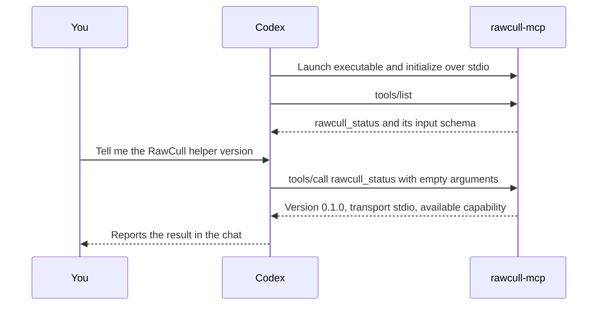

# RawCull MCP implementation plan

Status: proposal for discussion. The first milestone is a local prototype. The first public release is a small, read-only catalog integration, subject to proving that the signed helper works when launched by an external AI client.

## What the user should be able to do

1. In RawCull, choose a catalog to make available to a desktop AI client.
2. Quit RawCull and ask the client about that catalog. The client starts a bundled MCP helper on demand.
3. In a later release, ask RawCull to analyze every supported photo, group bursts, and rank candidates. Ask the assistant to compare the top frames and revisit uncertain picks.
4. Open RawCull later and review a saved draft with suggested keepers, alternatives, and reasons. Apply individual picks or an explicitly selected batch using the existing culling workflow.

The first release stops after step 2. A good demo is “How many photos are in this catalog, and what cameras and capture dates does it cover?” It proves client setup, catalog authorization, a useful tool call, and operation with the app closed before introducing models, image sharing, and catalog writes.

## How a local MCP call works

MCP stands for Model Context Protocol. It gives an AI client a standard way to discover tools, call them with arguments, and receive results. In this setup, Codex is the client and `rawcull-mcp` is the server. The RawCull window and the MCP helper are separate processes. A local server can be a small executable that starts on demand and waits for messages.



1. **Codex starts the helper.** The MCP configuration gives Codex the absolute path to `rawcull-mcp`. Codex launches that executable and connects two pipes to it. `stdio` means that the client sends messages through the helper's standard input and reads replies from its standard output. There is no local web address or port to configure. When the client closes the input pipe, the helper exits.
2. **Codex discovers the tools.** After the MCP handshake, Codex sends `tools/list`. The helper returns the name `rawcull_status`, a description, and a JSON schema that says this tool takes no arguments. That information tells the model what operation it can use and how to call it.
3. **The model interprets your prompt.** When you ask for the helper version, the model in Codex chooses `rawcull_status`. Codex turns that choice into a structured MCP request. The helper receives the tool name and arguments. Codex retains the natural-language prompt and conversation.
4. **The helper runs Swift code.** The MCP Swift SDK decodes the request and hands it to the `CallTool` handler. The handler validates the tool name and arguments, then returns version `0.1.0`, transport `stdio`, and the available capability. The implementation lives in [the helper's main.swift](../Tools/RawCullMCP/Sources/RawCullMCP/main.swift).
5. **Codex shows the result.** The helper returns a human-readable line and structured JSON. Codex can use that response to answer you or decide what to call next. The terminal line `Called rawcull.rawcull_status` identifies the server and tool that actually ran.

For example, the request in step 3 looks like this on the wire. The numeric ID lets Codex match the reply to the request.

```json
{"jsonrpc":"2.0","id":1,"method":"tools/call","params":{"name":"rawcull_status","arguments":{}}}
```

An eventual burst review would work the same way with more tools. Codex would interpret “pick one keeper per burst,” start analysis for an authorized catalog ID, poll for progress, and request the ranked frames. RawCull's analysis code would do the scanning, scoring, and grouping. If preview sharing were enabled, the assistant could inspect selected frames, then send structured suggestions to a draft-saving tool. Opening the draft in RawCull would let you decide which picks to apply. These tools are planned for later phases.

The helper runs locally on the Mac. Where the model interprets your prompt depends on the client and model you use. A cloud model may receive data that a tool returns. Today the helper returns only its status. The later preview-sharing setting will determine whether the helper can return image previews for the selected catalog. [MCP Swift SDK](https://github.com/modelcontextprotocol/swift-sdk), [MCP stdio transport](https://ruby.sdk.modelcontextprotocol.io/server/transports/)

## What RawCull can reuse

| Existing code | Role in the integration |
| --- | --- |
| [ScanFiles](../RawCull/Actors/ScanFiles.swift) and RawParserKit | Reuse supported RAW formats and catalog discovery rules. Check which scan and metadata operations can run without UI state or GUI-owned caches. |
| [CatalogLifecycleCoordinator](../RawCull/Model/ViewModels/CatalogLifecycleCoordinator.swift) | Shows how RawCull holds security-scoped access during work. The helper needs its own verified access for each scan or job. |
| [BurstAnalysisCoordinator](../RawCull/Intelligence/BurstAnalysis/BurstAnalysisCoordinator.swift) and RawCullCore | The coordinator already orchestrates sharpness, similarity, grouping, and ranking, but takes app callbacks and publishes through app state. Extract only the analysis operations the helper needs. Keep the existing app entry point and use its results to check parity. |
| [RawCullIntelligenceRuntime](../RawCull/Intelligence/Composition/RawCullIntelligenceRuntime.swift) | Starting point for understanding model discovery and initialization. Verify model access and memory use in the helper before promising headless analysis. |
| [CullingModel](../RawCull/Model/ViewModels/CullingModel.swift) | Existing APIs for ratings and burst winner overrides. The app uses these when the user applies a draft. The helper writes proposals to a separate draft store. |

## Phase 0 — Prove the launch and sandbox

### Run the local status prototype

From the repository root, build the standalone Swift package. The first build fetches the locked Swift dependencies.

```sh
swift build --package-path Tools/RawCullMCP -c release --force-resolved-versions
```

Point a desktop MCP client's local stdio server configuration at the absolute path to `Tools/RawCullMCP/.build/release/rawcull-mcp`. For example, to register it in Codex CLI from the repository root:

```sh
codex mcp add rawcull -- "$PWD/Tools/RawCullMCP/.build/release/rawcull-mcp"
```

Start a new client session and ask, “Use `rawcull_status` to tell me the RawCull MCP helper version and available capabilities.” Expect version `0.1.0`, transport `stdio`, and the single capability `rawcull_status`. RawCull itself can be closed. Use the bundled build below to test the installed app layout.

### Test the bundled helper with TestFlight

Xcode builds the helper as a separate target and copies it to `Contents/MacOS` inside `RawCull.app`. The helper has its own bundle identifier and App Sandbox entitlement because Codex launches it directly. Its identifier is also embedded in the executable's `Info.plist` so macOS can identify it when applying the sandbox. The status prototype requires only the two pipes from Codex. It has no catalog grants or network entitlements. [Apple's guidance on identifying a sandboxed command-line executable](https://developer.apple.com/forums/thread/802443)

Upload an internal build with `./Scripts/release.sh internal` and install it from TestFlight after Apple processes it. Quit RawCull, then confirm the helper is present and signed. Adjust the path if RawCull is installed elsewhere.

```sh
helper=/Applications/RawCull.app/Contents/MacOS/rawcull-mcp
codesign --verify --strict --verbose=2 "$helper"
codex mcp add rawcull-testflight -- "$helper"
```

Start a fresh Codex CLI session and check `/mcp` for `rawcull-testflight: connected (1 tool)`. Ask “Call `rawcull_status` on the `rawcull-testflight` MCP server and tell me the helper version and available capabilities.” Confirm that Codex shows a tool call to `rawcull-testflight.rawcull_status` and reports `0.1.0` over `stdio`. The distinct server name lets you keep the standalone prototype registered during the test.

### Implementation sequence

1. Build a small Swift executable using the [official MCP Swift SDK](https://github.com/modelcontextprotocol/swift-sdk). Pin a tested revision. Use the SDK's stdio transport and one tool, `rawcull_status`, that reports the helper version and supported capabilities. Keep protocol messages on stdout and diagnostics on stderr or in unified logging.
2. Run it from an MCP test client, then from one desktop AI client that supports launching a local stdio server. Verify discovery, invocation, and exit on client disconnect. Record the tested client version and configuration.
3. Embed and sign the helper in a Release build. Repeat the test from an installed copy with the RawCull UI closed. Test the external client itself as the launcher, since Apple's sandbox inheritance example describes a tool launched by its containing app. Validate the archive's nested signing and entitlements. A working executable launched from Xcode or Terminal does not prove this path. [Apple's embedded tool guidance](https://developer.apple.com/documentation/xcode/embedding-a-helper-tool-in-a-sandboxed-app)
4. Prove one catalog grant end to end. Select a folder in RawCull, persist the minimum grant information, quit RawCull, and have the externally launched helper resolve access and read a supported file. Verify the actual behavior with the intended sandbox, signing, storage, and client configuration. Treat shared storage, bookmark resolution, and access to the RAW folder as distinct checks. An application group can share data between eligible processes, while file access depends on the sandbox and bookmark mechanism. Test after relaunch and after revocation. [Apple's sandbox file access guidance](https://developer.apple.com/documentation/security/accessing-files-from-the-macos-app-sandbox)

**Decision gate.** Proceed with the closed-app release if the signed path works without weakening the sandbox or requiring broad disk access. If it fails, identify whether launch, grant resolution, or shared storage is the blocker. An app-mediated integration can still validate the MCP workflow with RawCull open. Investigate a user-enabled bundled service separately if independent background operation remains a requirement. [Apple's background process guidance](https://developer.apple.com/documentation/appkit/managing-ongoing-background-processes-in-your-mac)

## Phase 1 — Ship one read-only workflow

The helper now has the first part of `list_catalogs`. It reads a single `catalog-grant.json` manifest from the dedicated `93M47F4H9T.no.blogspot.RawCull.mcp` app group and returns the catalog's opaque UUID (`id`) and `displayName`. An absent manifest represents no authorized catalog. RawCull still needs to write and revoke the manifest from its settings, and the signed build needs to verify app group access before catalog scanning is added.

1. Add a small settings surface to enable the integration, authorize a single catalog for the pilot, revoke it, and show setup instructions for the tested client. Use an opaque catalog ID. Tool calls accept that ID and never accept arbitrary filesystem paths. Grant resolution stays inside the helper.
2. Add the tools below. Define typed schemas, bound page sizes, and return structured results. For the pilot, return file names and selected capture metadata such as capture time and camera model. Omit absolute paths, location metadata, and image bytes. Define whether discovery includes subfolders using the existing catalog semantics.
3. Use one catalog snapshot per scan for consistent pagination. Put an upper bound on work per call. If representative catalogs exceed the client's deadline, return a job ID and offer status polling before shipping. Report permission failures, unavailable folders, and incomplete scans explicitly so the assistant cannot mistake them for an empty catalog.
4. Run a signed end-to-end smoke test on a clean user account and through the planned beta distribution path. Quit RawCull, start a fresh client session, enumerate the authorized catalog, and compare counts and a sample of metadata with RawCull. Exercise a large catalog, a moved or disconnected folder, revoked access, invalid IDs, pagination, and an upgrade from the prior RawCull version. Verify that the helper exits when its client disconnects and that a disabled integration returns no catalog data.
5. Distribute a small beta through Mac TestFlight if available for the release workflow. Give testers a setup guide and one example prompt. Ask where setup failed, whether the client reported the right catalog, and how long the first useful answer took. Track support issues without collecting photo contents.
6. Submit the bundled helper with an update under RawCull's existing Mac App Store listing. In review notes, describe how to enable it, reproduce the read-only demo with a sample catalog, and verify behavior with the app closed. Include the helper's launch and exit behavior and the catalog access model. A separate Store listing is unnecessary for a helper shipped inside the app bundle. App Review applies to the complete submission. [Mac App Store review guidelines, section 2.4.5](https://developer.apple.com/app-store/review/guidelines/#hardware-compatibility)

| Pilot tool | Result |
| --- | --- |
| `rawcull_status` | Helper and protocol-facing schema versions, integration status, and available capabilities. |
| `list_catalogs` | Authorized catalog IDs and display names. At most one catalog in the pilot. |
| `catalog_summary` | Scan status, supported photo count, capture date range, and available camera breakdown. |
| `list_photos` | Bounded page of photo IDs, names, and selected metadata, plus a cursor tied to the scan snapshot. |

**Release gate.** A beta tester can install and configure the helper, get a correct catalog summary with RawCull closed, and revoke access using the documented workflow.

## Phase 2 — Add catalog analysis and burst recommendations

1. Move the minimum reusable scan and burst orchestration into a module available to the GUI and helper. Start with sharpness, similarity, grouping, and the existing ranking engine. Compare the helper's output with RawCull for the same catalog, settings, and available models. Start with separate helper analysis artifacts where necessary. Share caches only after checking format compatibility and concurrent access.
2. Add `start_catalog_analysis`, `get_analysis_status`, `cancel_analysis`, and paginated `list_bursts`. Return a job ID immediately. Report files scanned and analyzed, skipped files with reasons, current stage, and terminal state. Start with one active analysis per helper and bound parallelism. For a client-owned stdio process, client exit can interrupt work. Define cancellation and cleanup accordingly and make retry safe.
3. Return the top ranked frames, evidence available to RawCull, confidence or cautions, and alternates for each burst. Include singleton counts and unevaluated photos in the catalog summary so the assistant can explain coverage. Use IDs tied to a catalog snapshot and validate against that snapshot throughout the job.
4. Measure completion time, memory, model availability, and agreement with the existing app on small and representative large catalogs. Check that running the app and helper together does not corrupt state or make normal review unusable. Use pilot feedback to decide which burst evidence or workflow to expose next.

## Phase 3 — Add visual review and a draft the user can open

1. Add an explicit preview sharing setting for the authorized catalog. A local helper can return images to a client that uses a cloud model. Tell the user this before enabling previews. Verify that the chosen client passes MCP image content to its vision model. [MCP media documentation](https://py.sdk.modelcontextprotocol.io/servers/media/)
2. Add `get_burst_previews` for a bounded contact sheet with frame labels and a mapping to photo IDs. Add a larger JPEG preview for selected close calls if the contact sheet is insufficient. Reuse the preview pipeline, cap resolution and response size, and omit embedded metadata. Give the assistant the ranking evidence and let it explain why it agrees or picks a different frame.
3. Add `save_review_draft`. Persist a versioned record with catalog and snapshot identity, job ID, timestamp, suggested winner and alternates, reason, and uncertainty. Validate that IDs came from the referenced scan and that a proposed winner belongs to its burst. Use atomic writes and an idempotency key so retrying a save cannot create duplicate drafts. Design the shared location and write ownership from the signed-build results in Phase 0.
4. Add a draft entry point in RawCull that opens the matching catalog and shows proposed versus current choices. Check that the referenced frames still match before applying. Surface moved, removed, or changed files and choices edited since the review. Apply accepted suggestions via the existing culling APIs and confirm persistence before showing success. Exercise two concurrent clients, an interrupted save, catalog changes, and manual edits while a draft is pending.

**Release gate.** A tester can ask for a burst review with RawCull closed, see that the correct draft survived the helper exiting, open it in RawCull, and apply only the suggestions they choose.

## What to consider after the pilot

Use feedback to prioritize richer review criteria, semantic search, or more catalog operations. If users need jobs to survive quitting the AI client, investigate an opt-in, bundled LaunchAgent managed by `SMAppService`. That changes who owns the job and adds lifecycle and permission work. Treat remote clients and unattended operation as separate decisions from the local pilot. [Apple Service Management](https://developer.apple.com/documentation/servicemanagement/)
