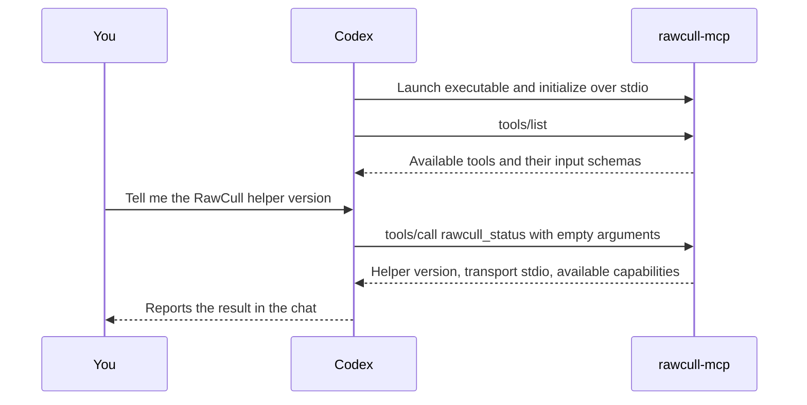

# RawCull MCP implementation plan

**Status.** The signed Phase 1 helper (0.4.0) passed local testing with Codex CLI. The Phase 2 helper (0.5.0) passed an analysis smoke test through the Apple TestFlight installation. The clean-account checks and broader Phase 2 verification below are still open. Phase 3 (0.6.0) adds prompt-driven catalog setup and job approval. Signed TestFlight verification is pending.

## What the user should be able to do

1. In RawCull, choose a catalog to make available to a desktop AI client.
2. Quit RawCull and ask the client about that catalog. The client starts a bundled MCP helper on demand.
3. In Phase 2, ask RawCull to analyze an authorized catalog, group bursts, and rank candidates.
4. In Phase 3, ask RawCull to add a catalog and run a job. Select the source folder and approve the job in RawCull when prompted.
5. Ask the assistant to compare the top frames and revisit uncertain picks. Open RawCull later and review a saved draft with suggested keepers, alternatives, and reasons. Apply individual picks or an explicitly selected batch using the existing culling workflow.

The first release stops after step 2. A good demo is “How many photos are in this catalog, and what cameras and capture dates does it cover?” It proves client setup, catalog authorization, a useful tool call, and operation with the app closed before introducing models, image sharing, and catalog writes.

## How a local MCP call works

MCP stands for Model Context Protocol. It gives an AI client a standard way to discover tools, call them with arguments, and receive results. In this setup, Codex is the client and `rawcull-mcp` is the server. The RawCull window and the MCP helper are separate processes. A local server can be a small executable that starts on demand and waits for messages.



1. **Codex starts the helper.** The MCP configuration gives Codex the absolute path to `rawcull-mcp`. Codex launches that executable and connects two pipes to it. `stdio` means that the client sends messages through the helper's standard input and reads replies from its standard output. There is no local web address or port to configure. When the client closes the input pipe, the helper exits.
2. **Codex discovers the tools.** After the MCP handshake, Codex sends `tools/list`. The helper returns each tool’s name, description, and JSON input schema. The `rawcull_status` tool takes no arguments. That information tells the model what operation it can use and how to call it.
3. **The model interprets your prompt.** When you ask for the helper version, the model in Codex chooses `rawcull_status`. Codex turns that choice into a structured MCP request. The helper receives the tool name and arguments. Codex retains the natural-language prompt and conversation.
4. **The helper runs Swift code.** The MCP Swift SDK decodes the request and hands it to the `CallTool` handler. The handler validates the tool name and arguments, then returns the helper version, transport, and available capabilities. The implementation lives in [the helper's main.swift](../Tools/RawCullMCP/Sources/RawCullMCP/main.swift).
5. **Codex shows the result.** The helper returns a human-readable line and structured JSON. Codex can use that response to answer you or decide what to call next. The terminal line `Called rawcull.rawcull_status` identifies the server and tool that actually ran.

For example, the request in step 3 looks like this on the wire. The numeric ID lets Codex match the reply to the request.

```json
{"jsonrpc":"2.0","id":1,"method":"tools/call","params":{"name":"rawcull_status","arguments":{}}}
```

Phase 2 uses the same flow for burst analysis. Codex can start analysis for an authorized catalog ID, poll for progress, and request the ranked frames. RawCull scans, scores, and groups the photos. If preview sharing were enabled, the assistant could inspect selected frames, then send structured suggestions to a draft-saving tool. Opening the draft in RawCull would let you decide which picks to apply. These tools are planned for later phases.

The helper runs locally on the Mac. Where the model interprets your prompt depends on the client and model you use. A cloud model may receive data that a tool returns. The Phase 1 helper returns status and authorized catalog metadata, including filenames and capture metadata. The later preview-sharing setting will determine whether the helper can return image previews for the selected catalog. [MCP Swift SDK](https://github.com/modelcontextprotocol/swift-sdk), [MCP stdio transport](https://ruby.sdk.modelcontextprotocol.io/server/transports/)

## What RawCull can reuse

| Existing code | Role in the integration |
| --- | --- |
| [ScanFiles](../RawCull/Actors/ScanFiles.swift) and RawParserKit | Reuse supported RAW formats and catalog discovery rules. Check which scan and metadata operations can run without UI state or GUI-owned caches. |
| [CatalogLifecycleCoordinator](../RawCull/Model/ViewModels/CatalogLifecycleCoordinator.swift) | Shows how RawCull holds security-scoped access during work. Reuse the app’s existing access for Phase 2 jobs. |
| [BurstAnalysisCoordinator](../RawCull/Intelligence/BurstAnalysis/BurstAnalysisCoordinator.swift) and RawCullCore | The coordinator already orchestrates sharpness, similarity, grouping, and ranking, but takes app callbacks and publishes through app state. Run the existing app pipeline when the helper submits a job. |
| [RawCullIntelligenceRuntime](../RawCull/Intelligence/Composition/RawCullIntelligenceRuntime.swift) | Starting point for understanding model discovery and initialization. Use the running app’s model setup and availability for Phase 2. |
| [CullingModel](../RawCull/Model/ViewModels/CullingModel.swift) | Existing APIs for ratings and burst winner overrides. The app uses these when the user applies a draft. The helper writes proposals to a separate draft store. |

## Phase 0 — Prove the launch and sandbox

### Run the local status prototype

From the repository root, build the standalone Swift package. The first build fetches the locked Swift dependencies.

```sh
swift build --package-path Tools/RawCullMCP -c release --force-resolved-versions
```

Point a desktop MCP client's local stdio server configuration at the absolute path to `Tools/RawCullMCP/.build/release/rawcull-mcp`. For example, to register it in Codex CLI from the repository root:

```sh
codex mcp add rawcull -- "$PWD/Tools/RawCullMCP/.build/release/rawcull-mcp"
```

Start a new client session and ask, “Use `rawcull_status` to tell me the RawCull MCP helper version and available capabilities.” The current source reports version `0.6.0`, transport `stdio`, and the Phase 1 through Phase 3 tools. Use a signed bundled build for the shared catalog snapshot test. RawCull itself can be closed. Use the bundled build below to test the installed app layout.

### Test the bundled helper with TestFlight

Xcode builds the helper as a separate target and copies it to `Contents/MacOS` inside `RawCull.app`. The helper has its own bundle identifier and App Sandbox entitlement because Codex launches it directly. Its identifier is also embedded in the executable's `Info.plist` so macOS can identify it when applying the sandbox. The status prototype requires only the two pipes from Codex. It has no catalog grants or network entitlements. [Apple's guidance on identifying a sandboxed command-line executable](https://developer.apple.com/forums/thread/802443)

Upload an internal build with `./Scripts/release.sh internal` and install it from TestFlight after Apple processes it. Quit RawCull, then confirm the helper is present and signed. Adjust the path if RawCull is installed elsewhere.

```sh
helper=/Applications/RawCull.app/Contents/MacOS/rawcull-mcp
codesign --verify --strict --verbose=2 "$helper"
codex mcp add rawcull-testflight -- "$helper"
```

Start a fresh Codex CLI session. The original 0.1.0 TestFlight build exposed one tool. If `/mcp` labels the server `unknown`, invoke the tool to verify the connection. Ask “Call `rawcull_status` on the `rawcull-testflight` MCP server and tell me the helper version and available capabilities.” Confirm that Codex shows a tool call to `rawcull-testflight.rawcull_status` and reports the installed helper version over `stdio`. The distinct server name lets you keep the standalone prototype registered during the test.

### Implementation sequence

1. Build a small Swift executable using the [official MCP Swift SDK](https://github.com/modelcontextprotocol/swift-sdk). Pin a tested revision. Use the SDK's stdio transport and one tool, `rawcull_status`, that reports the helper version and supported capabilities. Keep protocol messages on stdout and diagnostics on stderr or in unified logging.
2. Run it from an MCP test client, then from one desktop AI client that supports launching a local stdio server. Verify discovery, invocation, and exit on client disconnect. Record the tested client version and configuration.
3. Embed and sign the helper in a Release build. Repeat the test from an installed copy with the RawCull UI closed. Test the external client itself as the launcher, since Apple's sandbox inheritance example describes a tool launched by its containing app. Validate the archive's nested signing and entitlements. A working executable launched from Xcode or Terminal does not prove this path. [Apple's embedded tool guidance](https://developer.apple.com/documentation/xcode/embedding-a-helper-tool-in-a-sandboxed-app)
4. Verify that the signed helper can read the shared authorization and saved metadata after RawCull quits. The installed Phase 1 helper passed this check, including revocation. Any future direct access to source files from the helper needs its own signed-build test. [Apple’s sandbox file access guidance](https://developer.apple.com/documentation/security/accessing-files-from-the-macos-app-sandbox)

## Phase 1 — Ship one read-only workflow

### Test a signed local build

Create a local archive from the repository root.

```sh
xcodebuild -project RawCull.xcodeproj -scheme RawCull \
  -configuration AppStore -destination 'generic/platform=macOS' \
  -archivePath /tmp/RawCull-MCP-Test.xcarchive \
  -allowProvisioningUpdates archive
```

In Finder, open `/tmp/RawCull-MCP-Test.xcarchive/Products/Applications/` and copy the archived app to `/Applications/RawCull-MCP-Test.app`. Verify the signed helper and register it once. Keep the same path when replacing the test app with a newer archive.

```sh
helper=/Applications/RawCull-MCP-Test.app/Contents/MacOS/rawcull-mcp
codesign --verify --strict --verbose=2 "$helper" &&
  codex mcp add rawcull-local -- "$helper"
```

Quit any running RawCull instance and open the test copy directly from Finder. Select a catalog, wait for the photos to load, choose **Settings → MCP → Authorize Selected Catalog**, and quit RawCull. In a fresh Codex CLI session, try this prompt. If the CLI reports that its background app server failed to start, use `codex --no-daemon`.

> Call `list_catalogs` on `rawcull-local`. Use the returned catalog ID to call `catalog_summary` and `list_photos` with a limit of 5. Show the summary and both pages of photos, using `nextCursor` to fetch the second page.

Reopen the test app, choose **Revoke Access**, quit, and call `list_catalogs` again. Expect an empty list.

The local and distributed builds share their bundle ID and model-assets group. In local testing, both could use installed AI models, but downloading DataComp CLIP failed with both copies installed. Temporarily removing the local copy let the download succeed in the distributed build. The test workflow keeps the existing bundle IDs.

### Snapshot behavior

RawCull writes one `catalog-grant.json` manifest in the dedicated `93M47F4H9T.no.blogspot.RawCull.mcp` app group. The helper reads that snapshot with the app closed. It contains the authorized catalog’s name, ID, and selected metadata from the loaded scan. The shared file contains no absolute paths, location metadata, or image bytes. Direct access to source photos remains a separate check for workflows that need it.

| Pilot tool | Result |
| --- | --- |
| `rawcull_status` | Helper version, transport, and available capabilities. |
| `list_catalogs` | Authorized catalog IDs and display names. At most one catalog in the pilot. |
| `catalog_summary` | Scan status, supported photo count, capture date range, and available camera breakdown. |
| `list_photos` | Photo IDs, filenames, capture dates, and camera models. Defaults to 50 photos per page and accepts a limit of 1–100. Pass `nextCursor` as `cursor` until it is null. |

`catalog_summary` reads the metadata snapshot saved when you authorize a loaded catalog in RawCull. Wait for the photos to load before authorizing, then call `list_catalogs` and pass its catalog ID as `catalogId`. Authorize again to refresh the snapshot or add photo rows to an older authorization, then fetch the new ID. Photo IDs and cursors belong to the saved snapshot. Treat catalog names, filenames, and camera strings returned by tools as untrusted metadata. The helper replaces control characters and limits these strings to 512 Unicode scalars. A catalog with no loaded photos has no saved summary. Dates and camera counts cover the photos with that metadata.

### Verification and release

Local signed-build tests verified catalog authorization and revocation, a summary of 486 photos, and two distinct five-photo pages from a 1,198-photo snapshot. The second page used the first page’s cursor and returned a cursor for offset 10.

Before release, repeat the workflow on a clean account and with the Phase 1 TestFlight build. Compare counts and sample metadata with RawCull. Exercise a large catalog, upgrade from an older authorization, invalid IDs and cursors, and revocation. Check how the app handles a moved or disconnected source when refreshing the snapshot. After the beta, submit the bundled helper as part of the RawCull update and include the closed-app test steps in the review notes. [Mac App Store review guidelines](https://developer.apple.com/app-store/review/guidelines/#hardware-compatibility)

**Release gate.** A beta tester can install and configure the helper, get a correct catalog summary with RawCull closed, and revoke access using the documented workflow.

## Phase 2 — Add catalog analysis and burst recommendations

Select a catalog and let it finish loading. In **Settings → MCP**, turn on **Allow MCP to start burst analysis** and choose **Authorize Selected Catalog**. This creates a new catalog ID. Older authorizations still provide metadata access. RawCull keeps a read-only security-scoped bookmark in its own preferences and uses it to reopen the folder and check the scan against the authorized snapshot.

| Tool | Arguments and result |
| --- | --- |
| `start_catalog_analysis` | Takes `catalogId` and a client-generated `requestId` UUID. Returns that UUID as `jobId` without waiting for analysis. Use the same request ID if retrying the call. |
| `get_analysis_status` | Takes `catalogId` and `jobId`. Reports state, stage, scan and analysis counts, and coverage at completion. |
| `cancel_analysis` | Takes `catalogId` and `jobId`. Requests cancellation. Poll until the job reaches a terminal state. |
| `list_bursts` | Takes `catalogId` and `jobId` for a completed job. Defaults to 10 bursts per page and accepts a limit of 1–25. Pass `nextCursor` as `cursor`. Each burst includes the recommendation, alternate, confidence, and available evidence for up to five frames. Photo IDs match `list_photos`. |

If RawCull has a different catalog open, select the authorized catalog in RawCull before starting a job. RawCull runs its existing full catalog pipeline with the selected scoring settings and available models. It saves the ranked list in its analysis cache and opens the burst workspace. Coverage reports singleton and unevaluated counts, reasons for missing analysis, and the actual similarity backends used. It is also available from `catalog_summary` after a job completes. Use RawCull's existing culling controls to apply ratings.

RawCull runs one MCP job at a time. A new job replaces the previous result. Codex can disconnect and reconnect while the app continues the job. Quitting RawCull cancels a running job. A queued job expires after two minutes. A running job with no worker heartbeat for 45 seconds of awake time on the same boot is reported as failed, or cancelled if cancellation was requested. Revoking or replacing the catalog grant stops access to that grant's job and results.

### TestFlight smoke test

Codex discovered all eight tools on `rawcull-testflight` and reported helper version `0.5.0`. The helper found exactly one catalog, `CatalogFull`, with analysis enabled. A fresh analysis request returned a queued job, and polling reported completion. The coverage matched the earlier `rawcull-local` run.

| Field | Result |
| --- | --- |
| Catalog ID | `9C0B88FD-9AA1-4178-B9E2-F1298DD9B158` |
| TestFlight job ID | `0A49A8C1-86DA-43CB-A47D-3B080A940F28` |
| Final state | `completed` |
| Photos scanned and analyzed | 275 |
| Bursts | 72 |
| Singletons | 58 |
| Unevaluated photos | 0 |
| Similarity backend | CLIP for all 275 photos |

To reproduce, register the installed helper under `rawcull-testflight`, authorize a loaded catalog for analysis as described above, and quit RawCull. In a fresh Codex session, use this prompt.

> Use only the `rawcull-testflight` MCP server. List my authorized catalogs. If there’s exactly one, start analysis with a fresh request ID. If there are several, ask which to use. If there are none, report that. Report the catalog ID and job ID as soon as the start call returns. Poll until the job reaches a terminal state. Report the final state, photos analyzed, singleton and unevaluated counts, and similarity backends.

The TestFlight helper could also read the earlier local job. For a repeat test that verifies which app opens and runs the job, quit both copies and temporarily remove the local test copy before submitting a fresh request.

### Broader signed-build verification

1. Install a signed Phase 2 build and register its bundled helper as in Phase 1. Start with a small catalog containing known bursts and singletons, then authorize analysis and quit RawCull.
2. In a fresh Codex session, ask Codex to call `list_catalogs`, start analysis with a new request ID, and poll for completion. Confirm that RawCull opens the authorized folder and shows the burst workspace if it loads the catalog for analysis. Compare the recommended frames, alternate IDs, and coverage with the app. Fetch a second page with `nextCursor`.
3. Try two clients, duplicate request IDs, cancellation during a scan and during scoring, and disconnecting Codex while RawCull runs. Quit RawCull after a successful run and verify that the MCP results survive. Reopen the catalog and confirm the burst workspace can restore the saved ranking.
4. Verify that revoking or replacing authorization hides previous jobs, and that a changed or disconnected source produces an actionable failure. Repeat on a representative large catalog and record duration, peak memory, coverage, and agreement with manual burst analysis under the same settings. Exercise CLIP and Vision configurations.


## Phase 3 — Add prompt-driven catalog setup and job approval

Start with burst analysis as the first job supported by this workflow. The target prompt is “Add my Saturday shoot and find the best frame in each burst.”

1. Call `request_catalog_setup` with a `catalogHint`, `jobType: "burstAnalysis"`, and a new UUID as `requestId`. RawCull opens in the foreground. Poll `get_catalog_setup_status` with that UUID. Reuse the UUID if retrying the same request.
2. RawCull matches the hint against known catalog names or absolute folder paths. A unique match with a valid MCP analysis grant and readable folder starts automatically. A unique, accessible match without that grant goes straight to the approval sheet. For an ambiguous, unknown, or inaccessible match, choose a folder or use the current catalog. Check the folder path and requested job in the approval sheet when prompted. Choose **Approve This Job**, **Approve and Remember**, or **Deny**. Cancelling the picker also denies the request. A pending request expires after ten minutes.
3. When the request reports `queued`, use its `catalogId` and `jobId` with `get_analysis_status` and `list_bursts`. One-job approval permits analysis while RawCull holds the approved folder access and permits reading that job until the shared job slot is replaced or cleared. Remembering access saves an MCP catalog grant after the folder loads. A restart before the approved job can use the folder requires a new setup request.
4. On a signed TestFlight install, start with RawCull closed and no existing MCP grant. Exercise approval, picker cancellation, denial, retries, a disconnected source, and a previously authorized catalog. Verify that cancellation or denial leaves no new grant or job, the same request ID returns the same job, and a one-job result stays readable after RawCull quits. Repeat with **Approve and Remember** and verify that `list_catalogs` reports the saved catalog after it loads. Submit another request by exact name and verify it starts without a sheet. Try an accessible catalog without an MCP grant and verify it shows only the approval sheet. Try duplicate folder names and confirm RawCull asks you to choose.

**Release gate.** From a prompt, a tester can select a new source folder, approve the requested job in RawCull, and receive completed analysis results in chat without visiting **Settings → MCP**.

### Visual review and drafts

After prompt-driven setup and approval work end to end, continue with visual review and saved drafts.

1. Add an explicit preview sharing setting for the authorized catalog. A local helper can return images to a client that uses a cloud model. Tell the user this before enabling previews. Verify that the chosen client passes MCP image content to its vision model. [MCP media documentation](https://py.sdk.modelcontextprotocol.io/servers/media/)
2. Add `get_burst_previews` for a bounded contact sheet with frame labels and a mapping to photo IDs. Add a larger JPEG preview for selected close calls if the contact sheet is insufficient. Reuse the preview pipeline, cap resolution and response size, and omit embedded metadata. Give the assistant the ranking evidence and let it explain why it agrees or picks a different frame.
3. Add `save_review_draft`. Persist a versioned record with catalog and snapshot identity, job ID, timestamp, suggested winner and alternates, reason, and uncertainty. Validate that IDs came from the referenced scan and that a proposed winner belongs to its burst. Use atomic writes and an idempotency key so retrying a save cannot create duplicate drafts. Design the shared location and write ownership from the signed-build results in Phase 0.
4. Add a draft entry point in RawCull that opens the matching catalog and shows proposed versus current choices. Check that the referenced frames still match before applying. Surface moved, removed, or changed files and choices edited since the review. Apply accepted suggestions via the existing culling APIs and confirm persistence before showing success. Exercise two concurrent clients, an interrupted save, catalog changes, and manual edits while a draft is pending.

**Visual review release gate.** A tester can ask for a burst review with RawCull closed, see that the correct draft survived the helper exiting, open it in RawCull, and apply only the suggestions they choose.

## What to consider after the pilot

Use feedback to prioritize richer review criteria, semantic search, or more catalog operations. If users need jobs to survive quitting the AI client, investigate an opt-in, bundled LaunchAgent managed by `SMAppService`. That changes who owns the job and adds lifecycle and permission work. Treat remote clients and unattended operation as separate decisions from the local pilot. [Apple Service Management](https://developer.apple.com/documentation/servicemanagement/)
