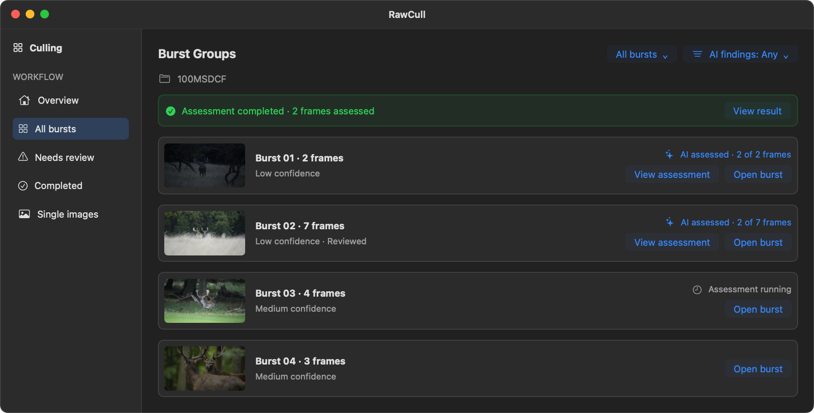
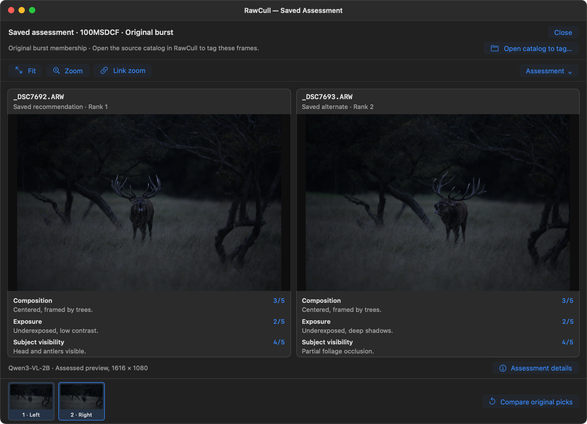

# View AI assessments in RawCull

Design proposal for review. Start implementation after the current MCP release checks are complete. The first increment uses the existing local Qwen photo assessment and shows its findings beside the photographs.

## What the photographer should be able to do

- Find assessed bursts in the burst list and see which frames were covered.
- Open the saved recommendation and alternate together with their AI findings.
- Compare those frames with any other verified member of the same burst, including frames outside the ranked preview returned by MCP.
- Tag or untag an individual frame using RawCull’s existing tagging action. Opening, assessing, comparing, marking reviewed, and advancing never change tags.
- Mark a burst reviewed using RawCull’s existing review action. Review is a photographer decision. An assessment can arrive before or after it.

In build 456, the preview model rated both frames 4/5 for subject visibility and reported foliage and shadow occlusion on one. The photos should dominate the view so the photographer can inspect where the foliage overlaps the subject. The text provides a reason to look. It cannot locate an obstruction precisely enough to draw a box or identify the species reliably.

The macOS mockups use embedded photo previews from the 26 September 2026 shoot. The burst memberships, review states, and findings shown are illustrative. The build 456 example used `_DSC7198.ARW` and `_DSC7197.ARW`.

## Sketch 1 · Burst list

Extend the existing Burst Groups results. Keep the current review filters and add an independent **AI findings** filter so photographers can combine it with **Needs review** or **Completed**. Keep AI summaries short and show selected findings in the workspace.

- Show assessed coverage against the full burst. A two-photo run on a seven-frame burst covers two frames, even if both requested frames succeeded.
- Show failure or partial coverage where it affects a row, for example **1 assessed · 1 failed** with full counts in the result. Leave unassessed rows uncluttered. Offer **With findings** as the initial additional filter. A running result can still appear in the unfiltered burst list.
- Select **View assessment** to preload the assessed pair. **Open burst** follows normal burst navigation, which gives access to every frame.
- Show a burst result on a live row only when the source and live group are verified to represent the same burst. If a catalog is regrouped, provide access to the original group through the saved result, as in Sketch 4. Never infer a match from a group number, filename, or pair of thumbnails.
- Preserve the list’s filter, scroll position, and selection when returning from a result. Use the existing **Next burst** behavior through the active queue, with no implicit review or tagging.

## Sketch 2 · Side-by-side assessment

Use the existing compare image panes and burst filmstrip where they fit. Both panes start at the same fit setting. Offer linked zoom and pan if supported by the viewport model, with independent inspection available. On narrow windows, collapse detailed findings behind a disclosure or move them into a lower pane before squeezing both previews.

The example findings paraphrase the build 456 log. The UI displays the actual preview type and dimensions from the assessment result. If the photographer displays a developed RAW, keep the assessment’s preview provenance visible. **Assessment details** shows the request time, requested criteria, model and revision when supplied, and source identity. Treat returned evidence as plain text. A collapsed card can show scores, with full evidence available on demand. Suppress rubric fields the request omitted. Display **Unknown** for a requested field with no score and retain any evidence the result supplies. Show per-photo errors separately from preview-display errors.

**Tag** operates on the visible frame only and reflects the existing tag state as soon as it changes. Give each button and accessible label the filename. Keep existing shortcuts only where their focus and target are unambiguous. Clicking a filmstrip thumbnail or changing keyboard focus selects a frame or pane without tagging. **Mark Reviewed** uses the verified live group and its existing review state. When the group cannot be matched, explain that review applies to a current burst and omit the action in the saved-result view.

## Sketch 3 · Compare with another frame

A seven-frame example shows how to look past the two assessed picks. The photographer chooses a pane, then chooses a filmstrip frame to place in it. The other pane stays pinned. Provide explicit **Show on left** and **Show on right** commands for keyboard and pointer users. Changing panes preserves the original assessment and leaves the filmstrip in source order. Frame labels show original source rank when available.

The blue outline identifies the right pane as the target. The left pane stays pinned.

The filmstrip labels in the sketch are abbreviated. Use a clear tag icon with **Untag** as the action for a tagged frame. For an unassessed frame, retain ordinary burst evidence if it exists and label its source. A failed assessment has its own error state. Do not launch a new model request when the photographer changes the frame. An explicit **Assess this frame** action can be considered later once the result viewer is proven.

## Sketch 4 · Open a result from completion, Settings, or MCP

Keep the result available from the burst list and add a **View result** action to recent assessments in **Settings → MCP**. A completion notice in RawCull can offer the same action while the app is open. Keep it lightweight. A successful background request does not take over the window.

**Completion notice in RawCull**

**Recent assessments in Settings → MCP**

If the saved result belongs to another catalog or the original group was replaced by regrouping, open a contextual **Saved assessment** presentation with the source catalog label and original frames. Use the same image and findings layout. Return to the previous workspace on close. Show a **Tag** action only when RawCull can resolve the photo to a loaded catalog through the normal tagging workflow. Otherwise explain that the photographer can open the catalog through its regular UI to tag. One-time analysis permission authorizes reading the source previews. It never stands in for permission to modify a catalog.

If photos have moved or changed, show an unavailable preview in the relevant pane and explain why. Display a still-authorized finding only as evidence from the original preview. Once a shared result is cleared, expires, is superseded, or loses consent, remove its findings from an already-open view and offer a return to the burst list. Never fall back to another result with the same filename.

A later MCP increment can offer an explicit presentation operation, tentatively `open_photo_assessment(requestId:)`. It should open exactly that authorized result, be discoverable only with compatible presentation support, and report success only after the app accepts the presentation request. It performs a UI action and should use the corresponding tool annotation. Return typed outcomes for unavailable, not ready, disabled, incompatible, or a workspace transition that prevents presentation. Use RawCull’s established launch and handshake path. **“Assess these and open the comparison when ready”** means wait for a terminal result and then call open if it is viewable. Repeated calls should focus the existing matching window. Keep image loading on-device and return presentation status to the client.

## Result identity and lifecycle

- Build the result context from catalog ID, source job ID, request ID, and burst and photo IDs from the source snapshot. Use the full saved membership for navigation. Preserve the source ordering and ranks when the live UI sorts by AF-point sharpness or regroups.
- Verify catalog-relative paths and file fingerprints through the existing resolver before opening previews. Respect the shared job’s active grant, current result, and assessment setting throughout presentation. Route permission and access failures into the view states above.
- Use the same authorized structured records as the MCP result tools. Keep the display state lightweight and avoid creating a second permanent findings cache. The current MCP contract keeps findings for up to 24 hours while the source and consent remain current. Remembered viewing preferences, manual tags, and review state follow their existing app rules.
- For repeated assessments, open the exact request when launched from Settings or MCP. From a burst row pick the latest available successful or partial request associated with that burst, and list other available runs under **Assessment** if there are multiple. Keep each run’s requested rubric and results together. An explicit-photo request can join a burst row only when its targets unambiguously map to one source burst. Cross-burst and singleton photo requests can open from recent assessments with a photo list in place of the burst filmstrip. Support for those explicit-photo presentations can follow the burst-first slice.
- Keep authorization and scope checks at the result reader, preview loader, and presentation boundary. Show loading placeholders per pane. Cancel stale preview loads as the user switches frames or results, and release scoped access when it is no longer needed. Fetch list summaries without loading photos beyond visible thumbnails.

## Implementation and review plan

| Step | Work | Review checkpoint |
| --- | --- | --- |
| 1 · Review the design | Walk through these sketches with a two-frame tie, a seven-frame burst with two assessed picks, and an assessment for a different catalog. Agree on result lifetime, tag placement, and the navigation labels. | Confirm how a photographer finds results, switches one compare pane, tags a frame, and gets back to the same list position. |
| 2 · Prove the result-to-photo link | Reuse the production result and snapshot resolution paths. Build a view-facing result context with authorized findings, original membership and ranks, and a verified mapping to any live group. Add invalidation handling before rendering real results. | Exercise two catalogs with identical names, regrouping, replaced files, one-time approval, and clear or revoke while the context is open. Findings must never attach to the wrong image. |
| 3 · Ship the local viewing path first | Add the burst row summary and filter, **View assessment**, and the paired image and findings layout. Connect filmstrip pane switching, existing manual tagging, and existing review state. Add a recent-result entry point in Settings. Start with burst-selector results. | On an installed candidate, reproduce build 456’s tied pair. Compare and manually tag one frame, switch to an unassessed frame in a larger burst, mark and unmark Reviewed, and return to the original list position. Confirm every other frame keeps its original tag. |
| 4 · Handle background and explicit-photo results | Add the completion action and contextual saved-result presentation. Include single-photo requests and explicit-photo selections spanning multiple bursts. Exercise narrow windows, keyboard focus, accessibility labels, and repeated opening. | Complete a request while another catalog is active. Open, inspect, then close it and resume the previous work. Verify the preview and tag availability states for a one-time result. |
| 5 · Add MCP presentation | Expose the explicit open operation after the local path is stable. Document the user prompt and test cold launch, active workspace, repeated open, and expired or cleared request IDs. | In TestFlight, ask MCP to assess and open one exact result. Compare the UI IDs and ranks with the payload. Confirm plain assessment completion does not switch the working view. |
| 6 · Revisit workspace scope | Watch how people navigate among multiple assessed bursts. Consider a dedicated review workspace only if the burst-list filter and Next burst flow leave persistent navigation friction. Reuse the viewer when Deep AI Review and Object Analysis get their own MCP results. | Decide whether an independent queue, longer-lived local findings, or additional review modes justify separate designs and storage rules. |

The release review should include a fully assessed pair, an exact score tie, an exposure-only run, a requested field with an unknown score, a partially failed batch, a frame beyond the first five, and a result cleared while open. Verify manual tags survive ordinary navigation through the existing tag implementation. Verify marking Reviewed never tags a frame or changes the assessment, and a new assessment never changes Reviewed. Check that loading covers only visible previews and nearby thumbnails when scrolling a large catalog.

## Code to inspect during implementation

- [Burst Groups sidebar](../RawCull/Views/SimilarityGridView/BurstGroupsSidebar.swift) and [burst cards](../RawCull/Views/CullingGrid/CullingBurstGroupCard.swift) for queue navigation and the list entry point.
- [Burst workspace](../RawCull/Views/ComparisonGridView/BurstCullingWorkspaceView.swift), [header](../RawCull/Views/ComparisonGridView/BurstWorkspaceHeader.swift), and [filmstrip](../RawCull/Views/ComparisonGridView/BurstWorkspaceFilmstrip.swift) for existing burst navigation and review.
- [Comparison grid](../RawCull/Views/ComparisonGridView/ComparisonGridView.swift), [image pane](../RawCull/Views/ComparisonGridView/ComparisonImagePaneView.swift), and [tag action](../RawCull/Views/ThumbnailComponents/ImageTableVerticalView.swift) for reuse.
- [MCP settings](../RawCull/Views/Settings/MCPSettingsTab.swift), [app worker](../RawCull/Main/MCPAnalysisController.swift), and [job store](../Tools/RawCullMCP/Sources/RawCullMCP/AnalysisJobStore.swift) for shared-result availability and recovery.
- [MCP contract and release checks](mcpserver.md#follow-up-photo-assessments) and [later review modes](aiandmcp.md#step-6--add-deep-ai-review-and-object-analysis-as-separate-increments).

## Open for design review

1. Should **View assessment** open side by side at every supported window size, or use a one-image-at-a-time presentation below a minimum comparison width?
2. Is the existing **Completed** filter enough for reviewed bursts with AI results, paired with **With findings**, or do photographers need a shortcut to that combined filter?
3. Is the existing shared-result lifetime enough for culling over multiple days? If durable local findings are needed, decide where they belong and what Clear and Revoke should mean before adding persistence.
4. Should a successful assessment completion have a notice only in the active RawCull window, or also in the app’s existing activity surface if its windows are in the background?
