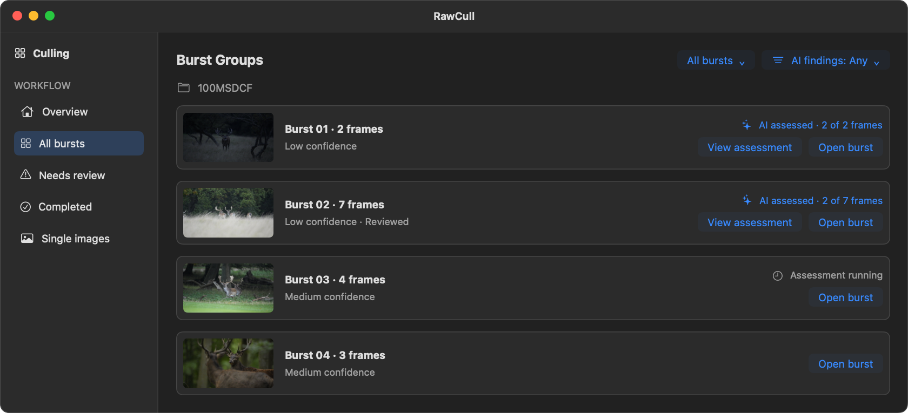
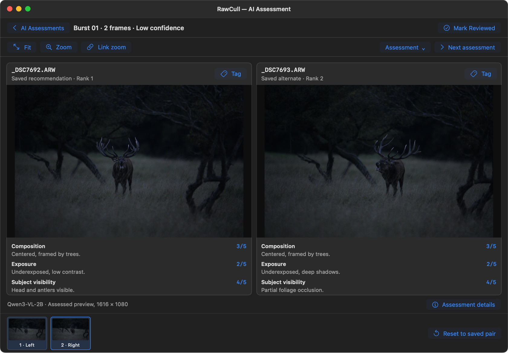
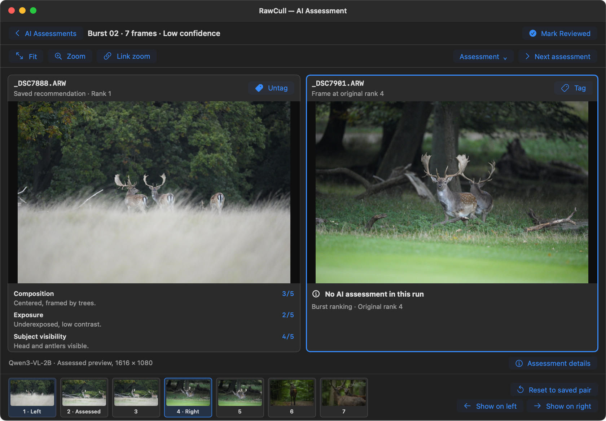
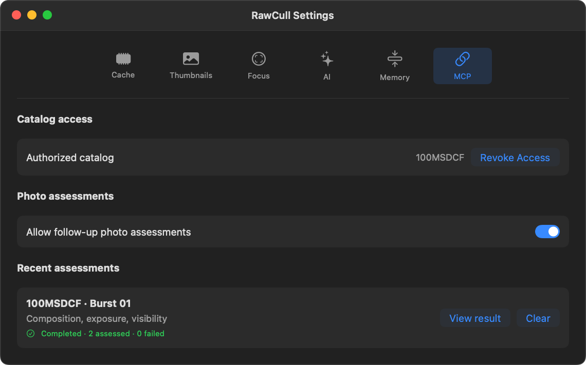

# View AI assessments in RawCull

Design proposal for review. Start implementation after the current MCP release checks are complete. The first increment opens a dedicated AI assessment window for viewable results from MCP-triggered local Qwen photo assessments.

The assessment window has its own results list, image comparison, and filmstrip. It becomes available once an assessment has findings ready to view. Existing RawCull browsing, Burst Groups, culling, and comparison views keep their current layouts and navigation. The assessment window can use shared photo-loading, tagging, and review actions. Closing it returns the photographer to their previous workspace.

A later increment connects assessments started manually in RawCull to this window. Results from the in-app action open in the same assessment views for the photos the photographer assessed, including an individual photo. Both triggers provide the viewer with the same result context. An MCP connection or job is needed only for MCP-backed results.

## What the photographer should be able to do

- Find available results in **AI Assessments** and see which frames were covered.
- Open the saved recommendation and alternate together with their AI findings.
- Compare those frames with any other verified member of the same burst, including frames outside the ranked preview returned by MCP.
- Tag or untag an individual frame using RawCull’s existing tagging action. Opening, assessing, comparing, marking reviewed, and advancing never change tags.
- Mark a burst reviewed using RawCull’s existing review action. Review is a photographer decision. An assessment can arrive before or after it.

In build 456, the preview model rated both frames 4/5 for subject visibility and reported foliage and shadow occlusion on one. The photos should dominate the view so the photographer can inspect where the foliage overlaps the subject. The text provides a reason to look. It cannot locate an obstruction precisely enough to draw a box or identify the species reliably.

The macOS mockups use embedded photo previews from the 26 September 2026 shoot. The burst memberships, review states, and findings shown are illustrative. The build 456 example used `_DSC7198.ARW` and `_DSC7197.ARW`.

## Sketch 1 · AI Assessments

Open the results list within the dedicated assessment window. Show only results with findings available to view, including partial results. Each row identifies the assessed burst and reports coverage against its full membership. A two-photo run on a seven-frame burst covers two frames. Show partial failures in the row when relevant, for example **1 assessed · 1 failed**, with full counts in the result.

- **View assessment** opens the saved pair and gives access to all verified members of the source burst through the assessment filmstrip.
- When showing live review state, verify that the source burst and live group are the same. If a catalog is regrouped, use the original burst membership as in Sketch 4. Never infer a match from a group number, filename, or pair of thumbnails.
- Preserve scroll position and selection when returning to **AI Assessments**. **Next assessment** advances within that list. Review and tagging require explicit actions.

## Sketch 2 · Side-by-side assessment

Build the two image panes and filmstrip as part of the new assessment view. Share image loading and viewport logic where appropriate. Both panes start at the same fit setting. Offer linked zoom and pan if supported by the viewport model, with independent inspection available. On narrow windows, collapse detailed findings behind a disclosure or move them into a lower pane before squeezing both previews.

The example findings paraphrase the build 456 log. The UI displays the actual preview type and dimensions from the assessment result. If the photographer displays a developed RAW, keep the assessment’s preview provenance visible. **Assessment details** shows the request time, requested criteria, model and revision when supplied, and source identity. Treat returned evidence as plain text. A collapsed card can show scores, with full evidence available on demand. Suppress rubric fields the request omitted. Display **Unknown** for a requested field with no score and retain any evidence the result supplies. Show per-photo errors separately from preview-display errors.

**Tag** operates on the visible frame only and reflects the existing tag state as soon as it changes. Give each button and accessible label the filename. Keep existing shortcuts only where their focus and target are unambiguous. Clicking a filmstrip thumbnail or changing keyboard focus selects a frame or pane without tagging. **Mark Reviewed** uses the verified live group and its existing review state. When the group cannot be matched, explain that review applies to a current burst and omit the action in the saved-result view.

## Sketch 3 · Compare with another frame

A seven-frame example shows how to look past the two assessed picks. The photographer chooses a pane, then chooses a filmstrip frame to place in it. The other pane stays pinned. Provide explicit **Show on left** and **Show on right** commands for keyboard and pointer users. Changing panes preserves the original assessment and leaves the filmstrip in source order. Frame labels show original source rank when available.

The blue outline identifies the right pane as the target. The left pane stays pinned.

The filmstrip labels in the sketch are abbreviated. Use a clear tag icon with **Untag** as the action for a tagged frame. For an unassessed frame, retain ordinary burst evidence if it exists and label its source. A failed assessment has its own error state. Do not launch a new model request when the photographer changes the frame. An explicit **Assess this frame** action can be considered later once the result viewer is proven.

## Sketch 4 · Open a result from completion, Settings, or MCP

For the first increment, a lightweight completion notice can open the exact MCP result via **View result**. Recent assessments in **Settings → MCP** offer the same entry point for reopening a result. Both open the separate assessment window. A successful background request leaves the active RawCull workspace in place.

**Completion notice in RawCull**

**Recent assessments in Settings → MCP**

If the saved result belongs to another catalog or the original group was replaced by regrouping, open a contextual **Saved assessment** presentation with the source catalog label and original frames. Use the same image and findings layout. Return to the previous workspace on close. Show a **Tag** action only when RawCull can resolve the photo to a loaded catalog through the normal tagging workflow. Otherwise explain that the photographer can open the catalog through its regular UI to tag. One-time analysis permission authorizes reading the source previews. It never stands in for permission to modify a catalog.

If photos have moved or changed, show an unavailable preview in the relevant pane and explain why. Display a still-authorized finding only as evidence from the original preview. Once a shared result is cleared, expires, is superseded, or loses consent, remove its findings from an already-open view and offer a return to **AI Assessments** or close the assessment window. Never fall back to another result with the same filename.

A later MCP increment can offer an explicit presentation operation, tentatively `open_photo_assessment(requestId:)`. It should open exactly that authorized result, be discoverable only with compatible presentation support, and report success only after the app accepts the presentation request. It performs a UI action and should use the corresponding tool annotation. Return typed outcomes for unavailable, not ready, disabled, incompatible, or a workspace transition that prevents presentation. Use RawCull’s established launch and handshake path. **“Assess these and open the comparison when ready”** means wait for a terminal result and then call open if it is viewable. Repeated calls should focus the existing matching window. Keep image loading on-device and return presentation status to the client.

## Result identity and lifecycle

- Build a result context with the catalog and result identity, the assessed photo IDs, and any verified source burst and ranks. For MCP results, include the source job ID and request ID. For manually started results, use the in-app run identity and capture the selected photos at assessment time. Use the full saved membership for navigation. Preserve the source ordering and ranks when the live UI sorts by AF-point sharpness or regroups.
- Verify catalog-relative paths and file fingerprints through the existing resolver before opening previews. For MCP results, respect the shared job’s active grant, current result, and assessment setting throughout presentation. For manually started results, use RawCull’s local catalog access and the availability of the in-app result. Route permission and access failures into the view states above.
- Use the authorized structured records from the MCP result tools for MCP requests. Adapt manually started runs to the same viewer context using their in-app records. Keep the display state lightweight and avoid creating a second permanent findings cache. The current MCP contract keeps findings for up to 24 hours while the source and consent remain current. Remembered viewing preferences, manual tags, and review state follow their existing app rules.
- Open the exact request or in-app run identified by the entry point. Keep each run’s requested rubric and findings together. Offer other available runs under **Assessment** if there are multiple. Show a photo list in place of the burst filmstrip when a selection spans multiple bursts, and a single image with its findings for a one-photo result. Start with MCP burst-selector results.
- Keep authorization and scope checks at the result reader, preview loader, and presentation boundary. Show loading placeholders per pane. Cancel stale preview loads as the user switches frames or results, and release scoped access when it is no longer needed. Fetch list summaries without loading photos beyond visible thumbnails.

## Implementation and review plan

| Step | Work | Review checkpoint |
| --- | --- | --- |
| 1 · Review the design | Walk through these sketches with a two-frame tie, a seven-frame burst with two assessed picks, and an assessment for a different catalog. Agree on result lifetime, tag placement, and the navigation labels. | Confirm how a photographer finds results, switches one compare pane, tags a frame, and gets back to the same list position. |
| 2 · Prove the result-to-photo link | Reuse the production result and snapshot resolution paths. Build a view-facing result context with authorized findings, original membership and ranks, and a verified mapping to any live group. Add invalidation handling before rendering real results. | Exercise two catalogs with identical names, regrouping, replaced files, one-time approval, and clear or revoke while the context is open. Findings must never attach to the wrong image. |
| 3 · View MCP-triggered results | Build the dedicated assessment window, results list, and paired image and findings view. Start with MCP burst-selector results and open them from completion or **Settings → MCP**. Connect pane switching and the existing tag and review actions. | Reproduce build 456’s tied pair. Switch to an unassessed frame, tag one frame, and mark or unmark Reviewed. Close the assessment and resume the previous RawCull workspace. |
| 4 · Expand MCP result coverage | Add contextual saved results, single-photo requests, and selections spanning multiple bursts. Exercise narrow windows, keyboard focus, accessibility labels, and repeated opening. | Open a one-time result while another catalog is active. Verify preview and tag availability and return to the previous workspace on close. |
| 5 · Support manually started assessments | Open results from RawCull’s in-app assessment action in the same viewer. Pass the exact run and verified source photo selection. | From RawCull, assess one photo and a selection of photos. Open each result and confirm that the displayed photos and findings belong to that run. |
| 6 · Add the MCP open command | Expose the explicit MCP presentation operation after the viewer is stable. Test cold launch, active workspace, repeated open, and unavailable requests. | In TestFlight, ask MCP to assess and open a specific result. Compare the UI IDs and ranks with the payload. Confirm plain assessment completion leaves the active workspace in place. |

The release review should include a fully assessed pair, an exact score tie, an exposure-only run, a requested field with an unknown score, a partially failed batch, a frame beyond the first five, and a result cleared while open. Verify manual tags survive ordinary navigation through the existing tag implementation. Verify marking Reviewed never tags a frame or changes the assessment, and a new assessment never changes Reviewed. Check that loading covers only visible previews and nearby thumbnails when scrolling a large catalog.

## TestFlight verification for Sketches 1 and 2

1. Use the installed TestFlight build to complete a burst assessment through MCP. Keep the source job current and note the request ID.
2. In the same TestFlight build, open **Window → AI Assessments** for the results list, or choose **View AI Assessment** from the matching burst to open its saved pair.
3. Check the source catalog, request ID, assessed-frame count, and source ranks against the MCP result. Use the filmstrip to put another frame in either pane, then use **Reset to saved pair** to return to the original recommendation and alternate. Tag and review controls use the open catalog when the corresponding photo or burst can be verified.
4. Return to the results list and reopen the same run. Use **Clear** in MCP Settings to verify that the open comparison loses access to the findings.

The viewer uses the existing shared result and its 24-hour lifetime. Confirm that the TestFlight build can use the saved source bookmark to display both previews.

## Code to inspect during implementation

- [Burst workspace](../RawCull/Views/ComparisonGridView/BurstCullingWorkspaceView.swift), [header](../RawCull/Views/ComparisonGridView/BurstWorkspaceHeader.swift), and [filmstrip](../RawCull/Views/ComparisonGridView/BurstWorkspaceFilmstrip.swift) for burst navigation patterns and the existing review action.
- [Comparison grid](../RawCull/Views/ComparisonGridView/ComparisonGridView.swift), [image pane](../RawCull/Views/ComparisonGridView/ComparisonImagePaneView.swift), and [tag action](../RawCull/Views/ThumbnailComponents/ImageTableVerticalView.swift) for image-loading and tagging behavior.
- [MCP settings](../RawCull/Views/Settings/MCPSettingsTab.swift), [app worker](../RawCull/Main/MCPAnalysisController.swift), and [job store](../Tools/RawCullMCP/Sources/RawCullMCP/AnalysisJobStore.swift) for shared-result availability and recovery.
- [MCP contract and release checks](mcpserver.md#follow-up-photo-assessments) and [later review modes](aiandmcp.md#step-6--add-deep-ai-review-and-object-analysis-as-separate-increments).

## Open for design review

1. Should **View assessment** open side by side at every supported window size, or use a one-image-at-a-time presentation below a minimum comparison width?
2. Should **AI Assessments** group available runs by catalog, burst, or completion time?
3. Is the existing shared-result lifetime enough for culling over multiple days? If durable local findings are needed, decide where they belong and what Clear and Revoke should mean before adding persistence.
4. Where should RawCull surface the completion notice when its windows are in the background?
